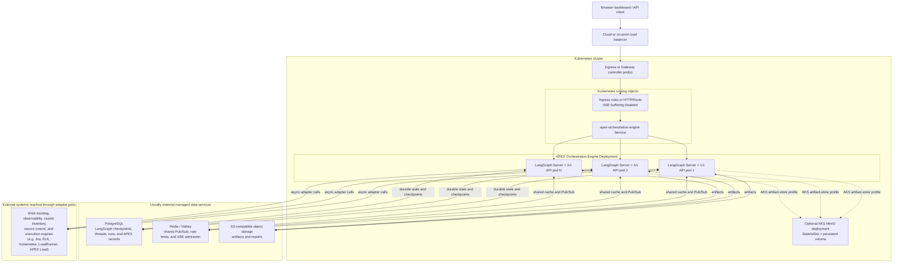

# ADR-0005: Deployment topology — one image, external data services, N stateless replicas

**Status:** accepted (2026-06-11)

## Decision
Production runs the standalone LangGraph server as a single container image built
with `langgraph build` (graphs + `/v1` app + auth handlers per `langgraph.json`),
deployed as N interchangeable stateless replicas (default 2) behind a plain
round-robin load balancer. Postgres, Redis, and the S3/MinIO artifact store are
**external** dependencies — provisioned and operated outside the app's deploy
artifacts (Helm chart `deploy/helm/apex-orchestration-engine/`, HA compose rig
`deploy/compose-ha/`; no bundled database subcharts). The compatibility-aware
`python -m apex.persistence.migrate` entry point runs against the `apex` schema
**before** every rollout. Migrations are additive, and
the migration runner registers trusted revision ancestry so a lineage-aware older
image accepts a newer descendant schema while rejecting behind, divergent, or
unknown heads. Old code on a newer schema is the supported rollback posture.

## Deployment topology

The Helm chart itself consumes external PostgreSQL, Redis, and object storage; the
dashed MinIO path is the Azure AKS profile, where MinIO is deliberately operated
as a separate PVC-backed in-cluster dependency. The Service can send a request or
a reconnected SSE stream to any ready replica because durable progress is in
PostgreSQL and cross-replica stream coordination is in Redis.

## Rationale
All durable state lives in Postgres (LangGraph checkpoints/threads/runs + the
`apex` schema), so replicas hold nothing: rolling restarts mid-run resume the
execution poll loop from the last committed checkpoint without double-starting
external load (`tests/integration/test_restart_survival.py`), and no sticky
sessions are needed — resumable SSE rides Redis pub-sub, so a re-joined stream
works from any replica. Bundling stateful services in the chart would couple
their lifecycle to app rollouts and invite accidental data loss; documenting
them as an external contract (values.yaml secret refs) keeps the chart a pure
consumer. The PDB and surge-first update strategy are availability guards only —
correctness never depends on a replica surviving.

## Consequences
- Scaling is `replicaCount`/HPA only; no per-replica state to migrate or drain.
- One ordering rule for releases: migrate, then roll pods (`docs/runbooks/deployment.md`).
- SSE imposes a proxy contract on every hop: buffering off, long read timeouts
  (`deploy/compose-ha/nginx.conf`, ingress annotations in values.yaml).
- **License gate:** the standalone server requires `LANGGRAPH_CLOUD_LICENSE_KEY`
  and custom auth requires the Self-Hosted Enterprise tier (ADR-0001). The HA
  soak rig is ready-to-run but gated on that key. Documented fallback if the
  license is declined: a thin identity-injecting gateway in front of the server
  (ADR-0003), at the cost of native per-resource authorization filters.
- Adapter secrets reach pods as env vars referenced by catalog `secret_ref`s
  (chart `extraEnv`), keeping the image generic across environments.
