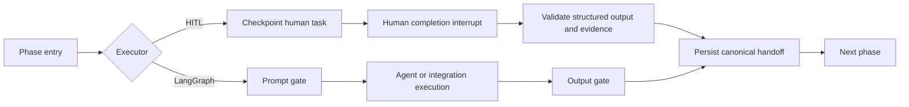

# Phase ownership and Reporting & Analysis

## Purpose and compatibility boundary

New wizard launches always plan all seven phases, in canonical order: Story Analysis, Test Planning, Env Triage, Script & Scenario, Execution, Reporting & Analysis, and Postmortem. A selected phase belongs to LangGraph; a deselected phase belongs to HITL. Human ownership is required work, not a skipped phase. The internal reporting identifier remains `reporting`.

Legacy API requests without `phase_execution` retain subset, `start_phase`, and `stop_after` behavior. Historical checkpoints are not converted into full workflows. Existing skipped statuses remain valid for historical runs. No database migration is needed for the ownership and analysis objects: they are stored in the existing durable run configuration JSON.

## Configuration contract

```json
{
  "phases": ["story_analysis", "test_planning", "env_triage", "script_scenario", "execution", "reporting", "postmortem"],
  "phase_execution": {
    "schema_version": 1,
    "owners": {
      "story_analysis": "langgraph",
      "test_planning": "langgraph",
      "env_triage": "hitl",
      "script_scenario": "langgraph",
      "execution": "langgraph",
      "reporting": "langgraph",
      "postmortem": "hitl"
    }
  },
  "analysis": {
    "schema_version": 1,
    "selections": [
      {"tool": "perfreportforge", "connection_id": "forge-analysis"},
      {"tool": "other", "connection_id": "metrics-analysis"}
    ],
    "timeout_s": 1800
  }
}
```

`PhaseExecution` requires exactly the canonical owner keys, each `langgraph` or `hitl`. It rejects a simultaneous subset or start/stop restriction. The existing `selected_phases()` method retains its legacy interpretation; `agent_phases()` supplies the phases requiring models, prompts, agent readiness and review gates. The durable snapshot is authoritative on resume. An authenticated explicit phase rerun uses a server-owned `rerun_phases` window while retaining the full original owner map, prompt manifest, analysis choices and scope snapshot. Public launch, native run and assistant APIs reject this override. Planned and agent phase helpers apply the window; legacy subset configuration remains unchanged.

Analysis selections use explicit connection identities. Each named tool can occur once; Other Tools can have multiple distinct connections. The same connection cannot appear twice. A configuration permits up to 16 selections. The optional deadline is 1–86400 seconds per analysis attempt, default 1800. New external-engine ownership workflows require at least one selection; legacy reporting without this object is unchanged. Simulation has no analysis integrations.

| Tool | LoadRunner | APEX Load | Connection kind/provider |
|---|---|---|---|
| LRA Engine | Yes | No | `analysis` / `lra_engine` |
| Internal RCA | No | Yes | `execution_engine` / `apex_load` |
| PerfReportForge | Yes | Yes | `analysis` / `perfreportforge` |
| Other Tools | Yes | Yes | `analysis` / `other` |

The server checks explicit connection availability, project access and provider compatibility. It resolves credentials through the connection infrastructure; credentials never belong in launch configuration, task output or analysis results. The operator-facing connection listing returns IDs, names, kind and provider only. Both facade launches and direct native launches validate analysis metadata.

## Wizard and draft behavior

Wizard configuration has schema version 2. Loading an older draft or golden setup interprets `phases: null` as all LangGraph, an explicit subset as LangGraph for its members and HITL for the remaining phases, and an empty subset as all HITL. Subset migration shows a human-completion notice. It never rewrites the original historical run. Browser retry protection checks the frozen pre-upgrade intent as a quarantine-only alias; it never replays the old subset body under the new contract. Automatic prompt migration preserves its original authored overrides in the draft so a lost-response launch cannot escape quarantine through normalization.

The Phase execution group exposes seven keyboard-operable buttons with pressed state meaning LangGraph, and accessible labels containing phase and owner. HITL choices stay readable. Upstream human phases satisfy plan membership; downstream execution still waits for their validated outputs.

Analysis controls are visible for real engines regardless of reporting ownership. Named tools use one connector selector. Other Tools uses a multiple connector selector. Changing engines preserves incompatible selections as errors until explicitly removed or replaced. Compatible selections and explicit connector IDs survive edits, autosave and launch intent hashing. Review lists all seven owners and chosen connector names.

Prompt edits, selected versions and custom review settings remain in the draft when ownership changes. Launch payloads include only agent-relevant prompts/model overrides. All-HITL workflows require no model prompt selection. Custom gate rows for human phases show “Human completion required.” Review counts distinguish prompt reviews, output reviews and human completion steps; automatic review does not remove human steps.

## Human execution path



The human task is checkpointed before interrupting. It includes phase, attempt/revision, task identity, required sections, upstream artifact IDs, selected tool requirements, engine and approved workload target. Phase status becomes `awaiting_human_completion`. It does not invoke phase agents, execution engines or analysis connectors.

The existing authenticated resume route accepts `action: complete`, `task_id`, `expected_revision`, and `output`; it also supports abort. The server stamps actor identity from authentication. The facade compares the current interrupt and task revision, validates the submitted output and sends an interrupt-ID-bound resume using synchronous durability and reject-on-active-run semantics. Stale or duplicate requests cannot consume a later task. Viewer access is denied. The graph independently checks the checkpointed task's phase/attempt/sections and revalidates output before persisting the handoff.

Invalid output keeps the task pending with a bounded actionable error. A 202 resume acknowledges receipt, not completion: the UI waits for graph validation and retains the operator’s draft across same-task errors, including repeated identical errors. Changes to task revision or evidence requirements discard that draft and reset buffered form fields. Completed phases record executor, actor, completion time and a separate `human_completion` approval entry. Logs include human wait duration without raw evidence. Run strips and detailed views expose owner and completion attribution, including accessible names.

### Human output requirements

The form supplies a structured `AgentDeliverable`: summary, phase-specific sections, evidence and (for test planning) workload scenarios/percentages. Completion must have a complete disposition. Existing artifact references must belong to the run.

A human-authored script/scenario feeding an agent-owned execution must additionally provide a valid `LoadTestSpec`. The server stamps the approved environment target. Arbitrary script references cannot override the existing approved provider workload binding; that binding remains configured through the execution connection/application release flow.

Human execution requires an engine-compatible external-results record, source URI and nonempty measured KPIs. A free-text completion note is insufficient. When Internal RCA is selected, the native APEX Load run identity is mandatory. The adapter verifies native project, terminal run state, application/release mapping and source console URL. Provider-derived measurements replace user-supplied measurements, and empty native measurements are rejected. Unverified native IDs cannot acquire RCA authority.

Human Reporting & Analysis requires the reporting deliverable and exactly one nonempty result-reference list per selected connection. Each list may reference selected run artifacts or safe external report URLs included in the deliverable's evidence. Missing, extra and duplicate references are rejected. These are human-supplied results, not evidence that a connector ran automatically.

## Analysis execution and recovery

Analysis tools execute before the reporting agent, in this order: engine-native option, PerfReportForge, Other Tools in saved order. Successful results are validated and persisted as analysis artifacts before reporting may finalize. The reporting agent reads complete validated results from each recorded run artifact and its original artifact-store connection, verifies the persisted content hash, and receives all findings, warnings, evidence gaps and provenance as untrusted evidence. Status previews are bounded and never used as the report’s evidence. If complete evidence exceeds the model-input budget, report assembly fails into recovery rather than silently dropping findings or uncertainty. Existing output-review policy applies to the assembled report.

The reporting phase stores a ledger per selection: tool, connection, input digest, idempotency key, remote job identity, status, attempt, polling count, digest-bound references to frozen execution evidence, result artifact ID and content hash, errors and timestamps. Deadline initialization, remote submission, polling and collection are separate checkpoint steps. A returned job identity is checkpointed before polling. A succeeded remote job remains `collecting` until validated results are durably stored. Collection failure must not make the phase succeed or cause a duplicate submission.

Polling starts at five seconds and backs off to thirty seconds. Transient status/transport errors retry within the deadline. External-service uncertain submission repeats the same idempotency key. Native RCA uses a separate durable submission receipt because native frozen-input deduplication does not cover every terminal state. Recovery after a polling/deadline/collection error preserves a known remote job. A deliberate retry after a terminal remote failure increments the attempt and creates a new key. Earlier successful selections remain succeeded and are not rerun.

An integration or report-assembly failure opens a recovery interrupt with Retry, Assign to HITL, and Abort. Reassignment records actor, reason and timestamp as a runtime override while preserving original launch ownership and collected artifacts. The human task includes selected-tool requirements; successful artifacts can satisfy their corresponding requirements. Aborting stops local polling; the ledger retains remote identities for operational follow-up. Remote cancellation is outside this contract.

Owned connection resolver checkouts and artifact store checkouts are explicitly released after each step, including error paths. Job and result objects reject credential material before checkpoint persistence. Logging records tool, connection, status, attempt and polling counts without credentials or raw evidence.

## External service contract (new gateway requirement)

This is a proposed integration contract, **not an assertion that existing LRA Engine or PerfReportForge services already expose these endpoints**. Deploy a compatible service or gateway for each external connection.

| Method | Path | Response |
|---|---|---|
| GET | `/v1/capabilities` | version 1, supported engines, accepted evidence kinds, availability |
| POST | `/v1/analyses` | job ID, normalized status, optional error |
| GET | `/v1/analyses/{job_id}` | same job identity and current status |
| GET | `/v1/analyses/{job_id}/result` | validated normalized result |

Capabilities must advertise `test_summary` evidence for the current orchestration submission. Probes only read capabilities. Submission contains schema version, run/phase/attempt, project, engine, frozen execution evidence, SHA-256 input digest and idempotency key. Evidence includes measured summary, source URI, artifact identities and verified native execution identity/connection where available. Artifacts stay behind the existing approved retrieval/access boundary; a gateway must have authorized access to referenced evidence. Credentials are connection-managed bearer authentication and do not appear in the request evidence.

The adapter sends `Idempotency-Key`. The service must return the same job for repeated identical submissions using the same key. Normalized statuses are `queued`, `running`, `succeeded`, `failed`, `cancelled`. Result fields: `schema_version`, `summary`, `tool`, `tool_version`, `input_digest`, `findings`, `artifacts`, `warnings`, `gaps`. Tool and digest must match the requested selection and frozen evidence. Evidence gaps, hypotheses and conflicting findings must remain distinguishable from confirmed conclusions.

### APEX Load Internal RCA

The adapter uses native `POST /api/v1/tests/{id}/archive/root-cause/analyses` and `GET /api/v1/tests/{id}/archive/root-cause/analyses/{analysis_id}`. It passes the stable submission key and uses the native service's frozen-input deduplication. Migration `0045` adds a durable native submission receipt. The server atomically claims an attempt before POST and persists the returned identity before updating graph state. A replay with a saved identity reuses it; a claim without an identity enters explicit uncertainty recovery and never silently POSTs again. An operator-approved retry starts a new attempt/key. The returned identity is also checkpointed for polling. Completion requires a current assessment; archive-changed or missing-assessment responses fail explicitly. Previously archived RCA is not substituted as proof of a new analysis.

Native archive availability, finalization, disabled RCA and stale-evidence conditions remain native service errors surfaced through recovery. The deployment must preserve native deduplication semantics; remote cancellation is not assumed.

## Verification and rollout

Regression coverage includes full ownership validation, legacy subsets and snapshot upgrades; all-HITL automatic-review execution across rebuilt checkpoints; invalid/stale/unauthorized/duplicate completion API requests; authoritative native measurements and binding failures; corrupted tasks and workload binding; exact per-tool reporting evidence; transient result collection; known-job retry; terminal-failure retry; credential-safe jobs/results; stable HTTP idempotency headers; wizard ownership/migration/readiness; and editable human evidence/KPI/workload forms.

Browser coverage exercises keyboard ownership changes, all seven visible controls, incompatible tool preservation, multiple Other Tools connections and named review summaries. Existing backend integration suites, dashboard Vitest, TypeScript, build and focused Playwright scenarios remain delivery gates.

Deploy optional backend contracts before enabling the new wizard payload. No historical configuration rewrite is required. This implementation adds no report formats or delivery destinations. Contract fixtures validate orchestration behavior; **production readiness still requires successful runs against each deployed LRA Engine, PerfReportForge, Other Tools gateway and the configured APEX Load RCA service**. Live service credentials/endpoints are not replaced by test fixtures.

### Implementation verification record — 2026-10-22

- Review-cycle backend regression suite: **186 passed**, including ownership, human completion/resume, rerun configuration, analysis ledger/receipt crash windows, full report evidence, and report failure recovery.
- Human completion UI suite: **127 passed**. Legacy launch quarantine, prompt migration/reload and durable idempotency: **32 passed**. Model admission history: **17 passed, 1 skipped**.
- Focused runtime Pyright: **0 errors**; analysis lifecycle, receipt and report modules/tests pass Ruff. Dashboard TypeScript passes.
- Fresh PostgreSQL migration through `0045` and Alembic drift check passed. PostgreSQL checks: **39 passed, 1 skipped**.
- Focused browser ownership workflow: **2 passed**, covering keyboard ownership, all seven phases, incompatible-tool retention, multiple Other Tools connectors, review names, structured human completion, bound task submission and actor attribution. Screenshot: `output/playwright/phase-ownership.png`.

Final combined backend/dashboard coverage, browser checks and independent review include the concurrent scope and prompt changes. Live external-service acceptance remains outstanding as described above; test fixtures are not production gateway certification.
