# APEX product design review — round 2

The interface now exposes the main actions, but it is not yet a coherent two-application workflow. The largest remaining usability costs are interpreting outcome states, preserving project context, and knowing exactly which decision or run is being acted on. Prioritize these before another broad restyling pass.

## Scope and method

This is a current-run heuristic audit, not user research or a WCAG conformance claim. Fourteen saved screenshots were read back and visually inspected. Orchestration used the existing authenticated Chrome session at port 3000; Load comparison used its running source preview at port 4000. The original Load tab on port 8080 was inspected only for orientation and is not screenshot evidence. All evidence in this report was captured during this review. The sampled Orchestration runs are old development records, including stub output. No launch, approval, message, abort, connection mutation, or preference change was performed. Responsive reflow, 200% zoom, touch target measurements, numerical contrast, all themes, screen-reader announcements, populated native integration, prompt/context editing, and success-path execution require a separate validation pass. Different selected themes and screenshot sizes are not evidence that shared color tokens are wrong.

## Prioritized findings

### P1 — Unify outcome meaning before further visual polish

Evidence: steps 1, 3, 12, 13.

Use separate orchestration, execution, acceptance, and evidence states. Add Not applicable for genuinely omitted execution, Not assessed for missing criteria, and Unavailable for retrieval failure.

**Acceptance check:** A completed orchestration plan never reads as a failure-like stop; planned versus observed Load duration is visible without interpreting a second panel.

### P1 — Make the cross-app scope explicit

Evidence: steps 4, 9, 11.

Provide a shared project/application breadcrumb and resolve configured mappings rather than carrying display names as identities. Distinguish integration workspace from launching the companion app.

**Acceptance check:** A user can tell which application and release each screen concerns, and a missing or ambiguous mapping gives a recovery path without silently choosing another project.

### P1 — Make approval identity and consequences unmistakable

Evidence: steps 2, 14.

Disambiguate duplicate runs and show what Approve or Modify will do next, with evidence freshness/provenance.

**Acceptance check:** Two otherwise identical approvals remain distinguishable, and the operator can explain what will execute after either decision.

### P2 — Give setup errors local recovery and plain language

Evidence: steps 4–7.

Label required fields, target error links at fields, explain configuration failure severity, and replace sim/all gated/rebind jargon.

**Acceptance check:** A first-time user can resolve each displayed issue without learning implementation vocabulary.

### P2 — Standardize navigation and information density

Evidence: steps 1–3, 7, 10–12.

Use one active-state convention, consistent button/tab geometry, and a common sidebar label budget. Give critical summaries more room than empty optional cards.

**Acceptance check:** Long navigation and decision labels remain readable; exactly one current destination is visually identifiable.

### P2 — Align accessibility semantics and focus

Evidence: steps 3, 6, 7, 10, 14.

Use radio groups for mutually exclusive choices, preserve roving tab behavior, target validation focus to fields, and disambiguate row actions.

**Acceptance check:** Keyboard and assistive-technology users receive the same selection, error, and run identity information as sighted pointer users.

### P2 — Explain data freshness and metric population

Evidence: steps 2, 11–13.

Show observation time and scope beside summaries. Distinguish no data, no execution, incomplete archive, and zero-valued results.

**Acceptance check:** An operator can tell whether a displayed zero is observed data or lack of evidence.

### P3 — Finish preference and recovery copy

Evidence: steps 5, 8–10.

Use role-aware connection guidance, Reload dashboard, consistent row options, and explicit preference scope.

**Acceptance check:** Recovery and preference controls describe their actual effect without explanatory workarounds.

## Captured walkthrough

### 1. Outcome overview — Needs refinement

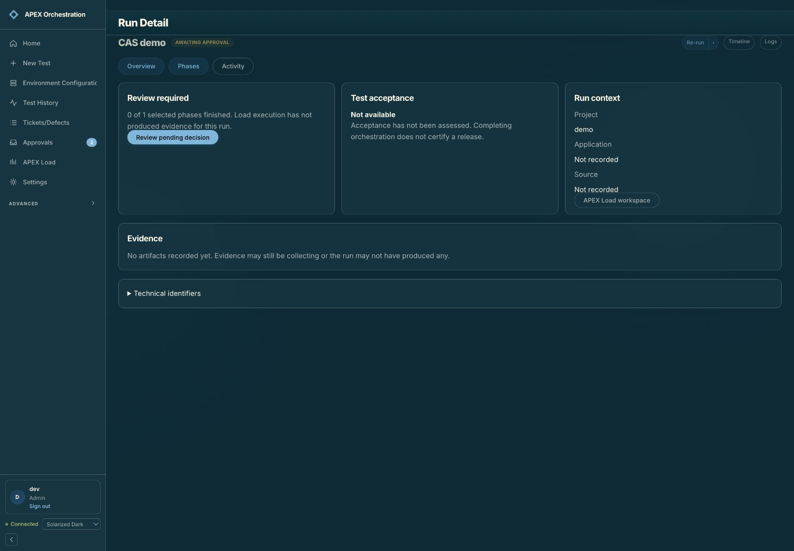

**Works:** The pending decision is easy to find, and orchestration progress is separated from test acceptance.

**Friction:** An analysis-only run still receives generic unavailable acceptance and missing Load evidence copy. Overview and Phases look similarly emphasized. Three equal cards give sparse metadata as much space as the decision.

**Recommendation:** Use “Not applicable — execution was not selected” when supported by the plan. Give the pending decision primary visual weight; make one navigation item visibly current.

**Evidence limit:** The selected run contains one Story Analysis phase; no real Load verdict was available.

### 2. Review a phase — Usable, with decision-context gaps

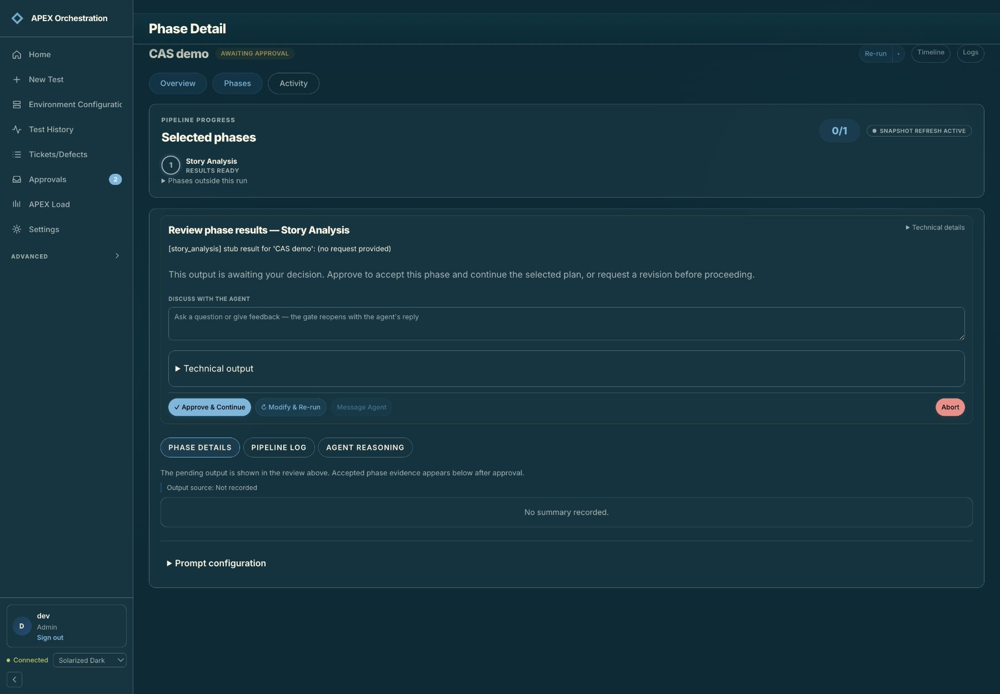

**Works:** Approve is prominent; a single Abort is separated from the positive action. Raw details are disclosed progressively.

**Friction:** The visible summary is a stub. “No summary recorded” appears below a pending summary, and “Snapshot refresh active” says little about freshness. Modify & Re-run does not name its scope or what will happen to later phases.

**Recommendation:** Show pending evidence and provenance together, label accepted evidence as not yet created, and describe the next phase and revision consequences using actual run state. Replace the freshness badge with a timestamp and connection state.

**Evidence limit:** No approval, revision, message, or abort was submitted. The sample cannot establish the quality of real generated evidence.

### 3. Find and distinguish runs — Needs refinement

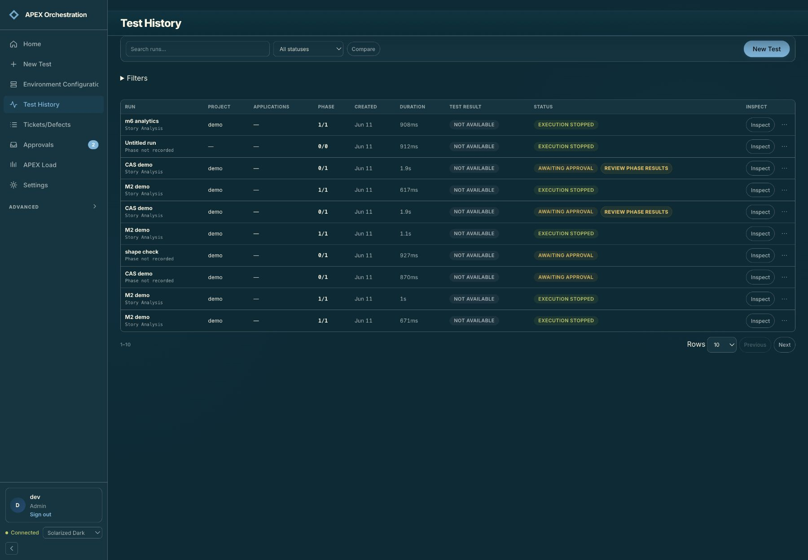

**Works:** Status and test result are separate; readable titles, search, project columns, and row limits support scanning.

**Friction:** Rows with 1/1 phases finished say “Execution stopped.” Repeated CAS demo/M2 demo titles and date-only Jun 11 make instances difficult to distinguish. Phase column contains progress rather than a phase name.

**Recommendation:** Separate completed orchestration from stopped/failed/aborted, independently of acceptance. Add time or short ID to ambiguous rows, label the column Progress, and give Inspect buttons run-specific accessible names.

**Evidence limit:** The dataset is old and sparse. Status wording is observed; no backend count or execution-state bug is inferred.

### 4. Set run scope — Usable, with guidance gaps

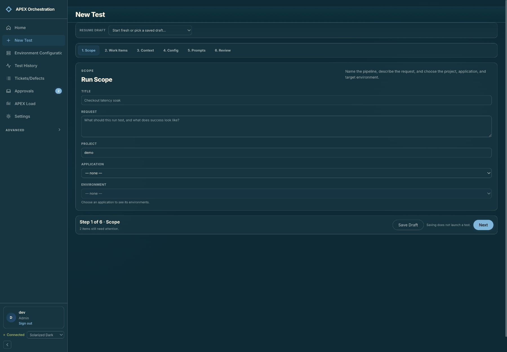

**Works:** Numbered steps, a clear Next action, and “Saving does not launch a test” establish the sequence.

**Friction:** Required fields are unmarked. “2 items still need attention” does not identify them here. Project is free text while Application is a picker. Inputs span a very wide desktop area.

**Recommendation:** Mark required fields and show local errors after interaction. Select a canonical project and show its application/environment relationship. Keep request text roomy but constrain short fields.

**Evidence limit:** Next with blank Title/Request moved to Work Items. Flexible navigation is acceptable; missing guidance is the issue. No draft was edited or saved.

### 5. Attach optional work items — Usable, with recovery gaps

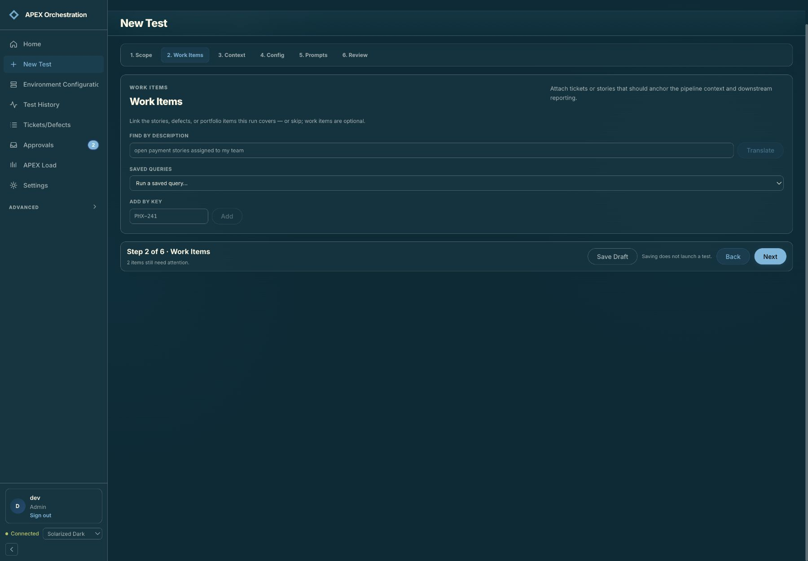

**Works:** The screen explicitly says work items are optional. Next moved focus to the selected step tab.

**Friction:** A saved query is disabled with “rebind required” and no nearby repair path. Translate describes an internal operation rather than the user goal.

**Recommendation:** Offer a permission-aware Fix connection/Open saved query action and explain what remains usable. Rename Translate to a goal-oriented action such as Find work items, while preserving a query preview where useful.

**Evidence limit:** The disabled query was inspected in the accessibility tree. No query was executed.

### 6. Choose execution and reviews — Needs refinement; one service path blocked

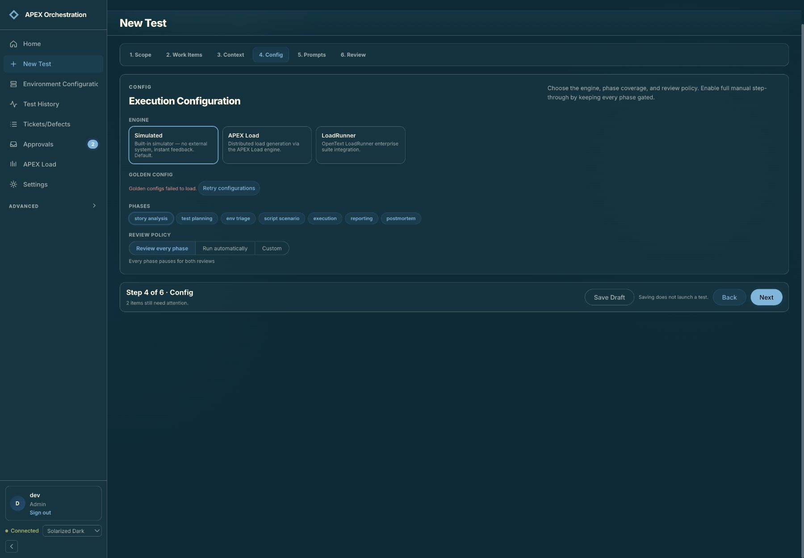

**Works:** The simulator is clearly distinguished from external engines, and configuration failure has a retry action.

**Friction:** Retry returned the same Golden configs error without explaining whether launch can continue. Phase chips use terse names. “Both reviews” hides how many interruptions the chosen plan creates. Mutually exclusive review modes are exposed as checkboxes.

**Recommendation:** Name the engine connection and readiness, explain optional configuration failures, offer an alternate recovery route, and summarize prompt/output review counts. Use radio semantics for a single review mode.

**Evidence limit:** One retry was observed. Root cause of the configuration failure and external engine readiness were not diagnosed in this design audit.

### 7. Review before launch — Functional, needs hierarchy

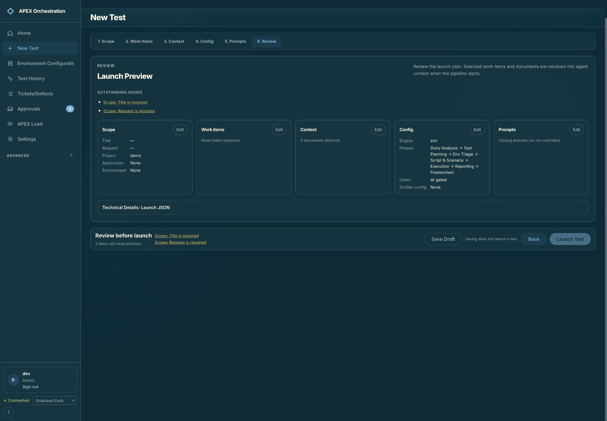

**Works:** Invalid launch is disabled. An issue link returns to Scope. Editable sections and hidden launch JSON support review.

**Friction:** Five equally weighted cards squeeze the important phase plan while optional sections are nearly empty. “sim” and “all gated” replace the friendly labels from configuration. An issue link focuses the Scope tab rather than the Title input; errors are duplicated in the footer.

**Recommendation:** Lead with a plain-language consequence summary: engine, environment, workload, review pauses, and next action. Condense empty optional sections. Preserve friendly names and target validation links to fields.

**Evidence limit:** No launch was performed; success, autosave, unsaved navigation, and execution start remain untested.

### 8. Recover from an app update — Recovered; minor copy issue

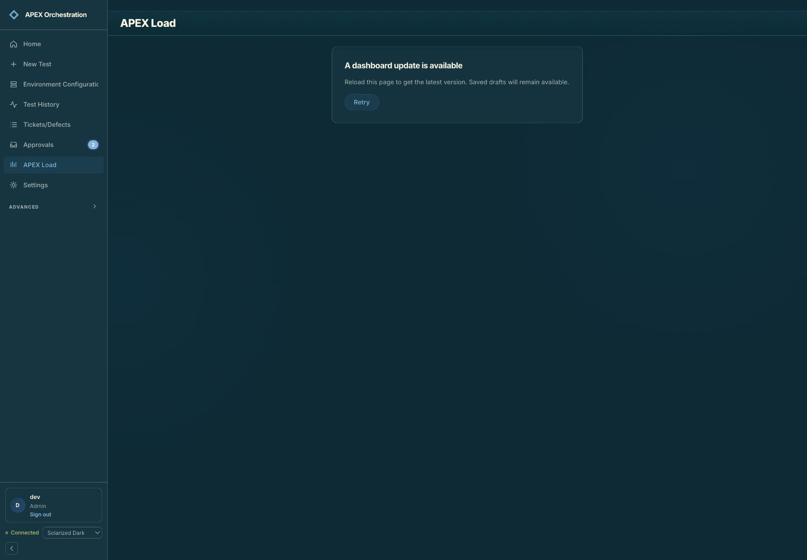

**Works:** The screen explains an update and protects the user from an opaque module error. Retry successfully reloaded the app.

**Friction:** The body asks users to reload but the button says Retry.

**Recommendation:** Label the action Reload dashboard and distinguish saved drafts from any unsaved input when applicable.

**Evidence limit:** This was a stale loaded bundle encountered after local rebuilds, not evidence of a persistent Load integration outage.

### 9. Enter the Load integration — Blocked for native handoff

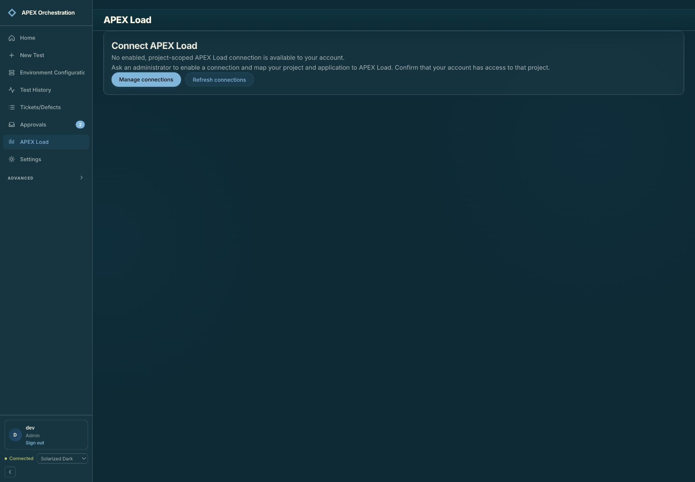

**Works:** The empty state explains project scope and gives Manage connections and Refresh connections actions.

**Friction:** The navigation item APEX Load opens an internal integration workspace, which may be mistaken for the companion application. Generic “Ask an administrator” copy is also shown to this Admin account.

**Recommendation:** Use “Load integration” or an explanatory subtitle, expose connection mapping/readiness, and tailor setup actions to the user role. Keep Open APEX Load a distinct destination when configured.

**Evidence limit:** No enabled project-scoped connection exists here. Native launch, populated reconciliation ledger, assessment retrieval, and the real round trip could not be tested.

### 10. Inspect personal preferences — Mostly healthy

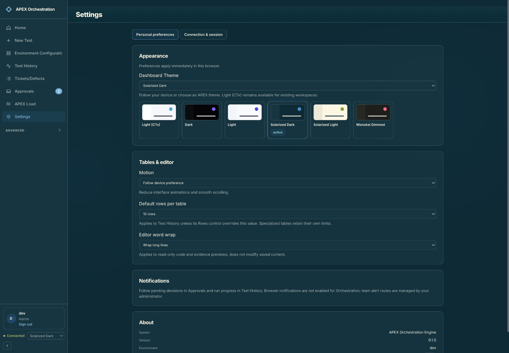

**Works:** Immediate browser-local scope, motion preference, and word-wrap behavior are explained. Settings are easy to find.

**Friction:** Theme selection is duplicated across a dropdown and swatches; System is only in the dropdown. Theme swatches expose checkbox semantics. Default rows per table applies only to History, with fewer choices than History itself.

**Recommendation:** Use one coherent single-choice theme group including System. Name the actual preference scope, align row choices, and turn notification destinations into links. Keep compatibility names such as CTx out of primary copy where possible.

**Evidence limit:** No preferences were changed. The screenshot is the top viewport, with part of About below the fold; cross-tab persistence and motion behavior were not tested.

### 11. Compare the current Load dashboard — Useful comparison; context mismatch

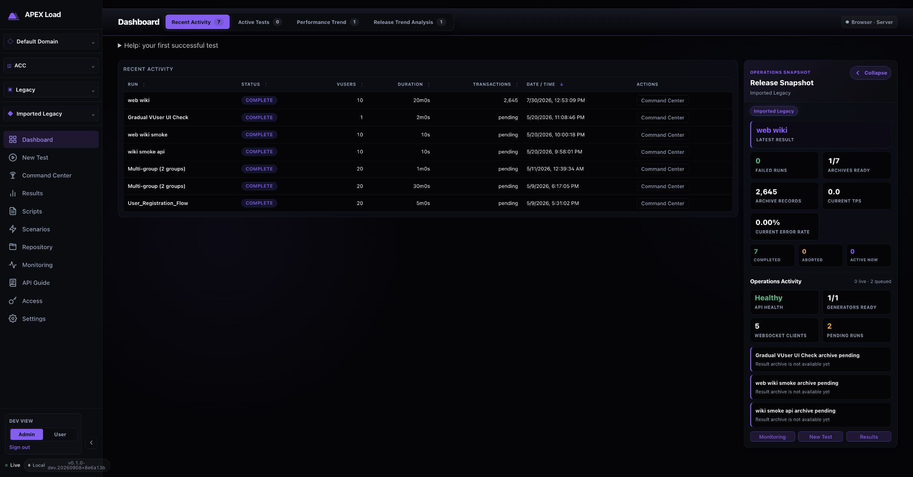

**Works:** Persistent Domain, Project, Application, and Release controls make scope visible. Operations and archive readiness are surfaced separately.

**Friction:** Orchestration has no comparable persistent scope. Navigation terms differ: Dashboard versus Home, Results versus Test History, Command Center versus phase/activity views. Brand marks and active-state treatments differ.

**Recommendation:** Adopt a shared suite header and scope breadcrumb, with app-specific actions beneath it. Reuse navigation and status conventions where meanings match; retain distinct execution and orchestration workspaces.

**Evidence limit:** Captured from the current source preview on port 4000. Its backend build badge describes the existing local backend. Different themes and viewport sizes prevent pixel-level visual comparison.

### 12. Inspect completed Load evidence — Strong model, with headline ambiguity

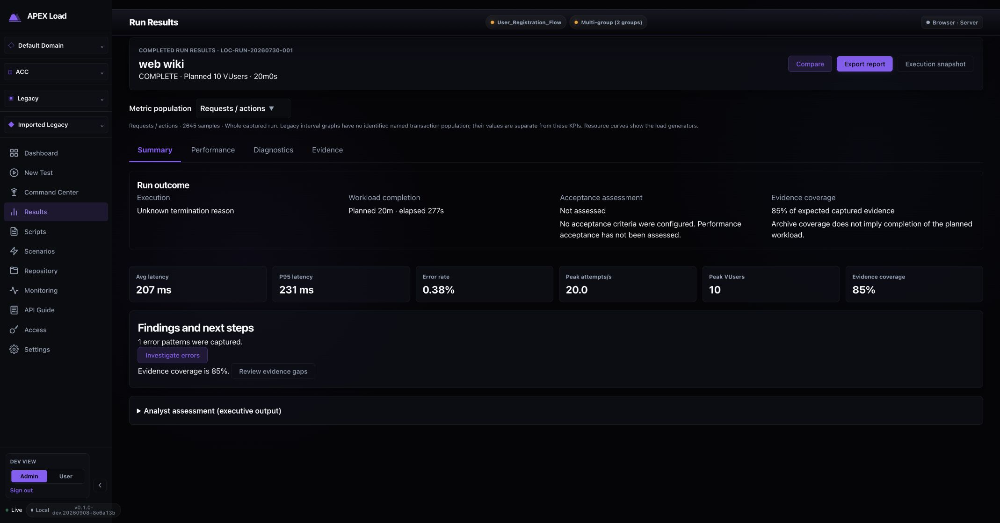

**Works:** Execution, workload completion, acceptance, and evidence coverage are distinct. Acceptance explicitly says no criteria were configured. Findings link to errors and evidence gaps.

**Friction:** The headline says COMPLETE and planned 20m0s, while the outcome says unknown termination reason and elapsed 277s. The caveat is present, but the headline can be read as workload completion.

**Recommendation:** Lead with a precise ended-state label and show planned versus observed duration together. Carry this four-part outcome model into Orchestration, adding orchestration phase completion as its own field.

**Evidence limit:** This native run has no supplied Orchestration origin. Absence of a return link here is not a demonstrated return-link defect.

### 13. Triage from Home — Useful priorities, weak metric definitions

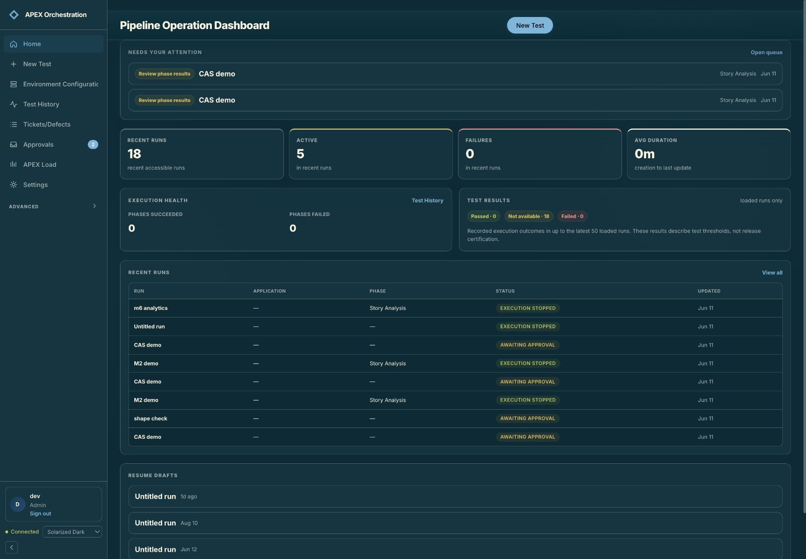

**Works:** Needs your attention leads the page and links directly to decisions. Loaded-run limits are disclosed for test results.

**Friction:** Active, phase-health counters, and creation-to-update duration lack a common time/scope explanation. Average 0m hides short durations. Large empty-health panels compete with work. Draft cards still show Untitled run without project.

**Recommendation:** Define active versus awaiting review, show freshness and time window, use suitable duration units, and give unknown/empty metrics informative states. Reuse descriptive draft labels from the wizard.

**Evidence limit:** Counts were not reconciled against backend data. The recommendation addresses interpretation, not a proven aggregation bug.

### 14. Triage the approval queue — Usable, with identification risk

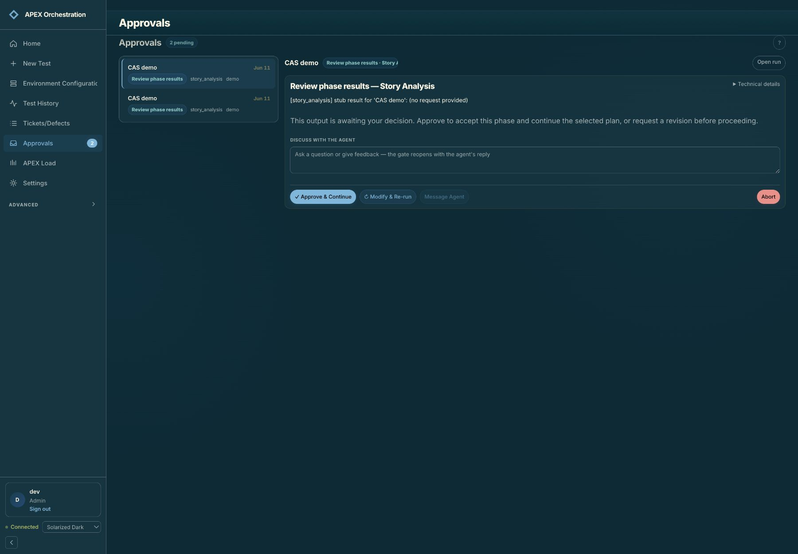

**Works:** Queue and preview support repeated review. Arrow Down changed the selected run and corresponding preview.

**Friction:** Two queue items share the same visible title, date, project, and machine-form phase. The preview status chip is visibly clipped. Users cannot confidently distinguish decisions without opening more detail.

**Recommendation:** Add waiting age and precise timestamp or short run ID, use friendly phase labels consistently, and avoid clipping the decision label. Include owner/requester only when known.

**Evidence limit:** Keyboard selection was sampled; no full screen-reader test or decision submission was performed.

## Integration opportunities

### Shared outcome summary

Project a single structured outcome into both apps: orchestration progress, execution stop reason, planned/observed duration, acceptance state and criteria, evidence coverage, and observation time. Do not derive a pass from COMPLETE.

Grounding: Steps 1, 3, 12.

### Context-preserving app switch

Resolve connection/project/application/release mappings and carry a canonical run correlation. Explain mismatches and require a deliberate selection where ambiguous. Provide Open execution in Load and Return to orchestration as explicit navigation.

Grounding: Steps 4, 9, 11.

### Evidence-level destinations

Link errors to Load Diagnostics and missing coverage to Evidence. Preserve the exact execution and population, and show source time. This is a proposed capability, not a verified supported link contract.

Grounding: Steps 2, 12.

### Analysis handoff visibility

Expose collection, analysis queued/running, review required, completed, and retry states with one next action. Verify with a real enabled connection before treating the existing ledger as sufficient.

Grounding: Step 9 (blocked).

### Shared visual contract

Align typography roles, spacing, sidebar widths, selected navigation, tables, buttons, focus rings, and semantic status colors. Maintain per-app theme choice; matching current screenshot colors is not the goal.

Grounding: Steps 1–14.

## Accessibility observations

Confirmed positives: named tab groups, labeled form controls, disabled invalid launch, step navigation moving focus, and arrow navigation changing approval selection. Confirmed risks in the captured accessibility tree: mutually exclusive review modes and theme swatches exposed as checkboxes; repeated Inspect labels lack run identity; the validation link returned to a step tab rather than its field. Visible clipping affects the sidebar and approval preview chip. Low-emphasis text and small controls warrant measurement; screenshots alone do not establish contrast or target-size failures.

## Suggested delivery order

1. Outcome semantics, run identity, and approval consequences.
2. Shared project context and a verified Load round trip.
3. Setup guidance, field-level recovery, and accessible selection semantics.
4. Visual consistency and responsive/zoom verification against the same selected theme and viewport.

Recommended usability study: ask representative operators to identify whether a run finished, determine whether acceptance was assessed, repair a missing configuration, distinguish two approvals, and open the matching Load evidence then return. Record wrong-run actions, incorrect pass interpretations, navigation backtracking, and time to the correct evidence. These are proposed measures; no user-study results were collected.