# APEX Resources UX audit — 2026-09-14

Consolidate supporting tools, separate inputs from run outputs, and preserve distinct editing workflows. The main problem is unclear ownership and inconsistent naming, rather than too many Resources links.

## Recommended organization

```text
Testing
  Home · Tests · Approvals · Tickets
Resources
  Applications
    Overview · Environments · Requirements · Documents · Linked presets
  Knowledge & Documents
    Documents · Saved summaries (when durable)
  Test Presets
  Prompts
    Application requirements · Pipeline prompts
Investigation
  Existing investigation destinations
  Evidence (cross-run, if needed)
Tests → Selected test/run → Evidence (primary home)
```

## 01. Applications & Environments — Mostly sound

Observed: Applications already group their environments, which is the right relationship. The page repeats its title and offers New environment globally alongside Add environment within an application.

Recommendation: Keep one Applications destination. Make application names open a detail workspace; place Environments, Requirements, Documents and linked Presets there as scoped views of canonical resources. Make New application the primary list action and Add environment the primary application action. Add search and project filters when supporting larger inventories.

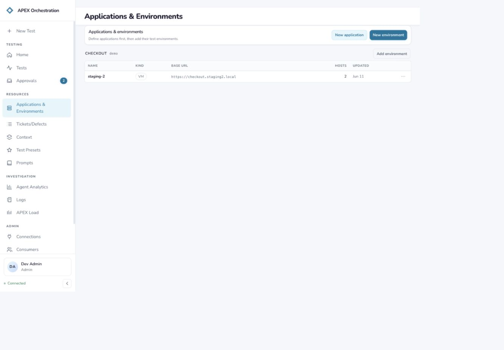

## 02. Environment detail — Needs clearer hierarchy

Observed: Reference and Inventory are meaningfully separated, and scan freshness is shown. The breadcrumb says Environment Configurations even though the sidebar says Applications & Environments. The heading Environment identifies the object type but not the selected environment. Empty JSON options occupy primary space.

Recommendation: Use Applications → Checkout → Environments → staging-2, with staging-2 as the main title. Rename Reference to Configuration, retain Inventory, and collapse advanced JSON options. Keep scan status and Rescan beside Inventory. Link to related tests without creating another environment catalog.

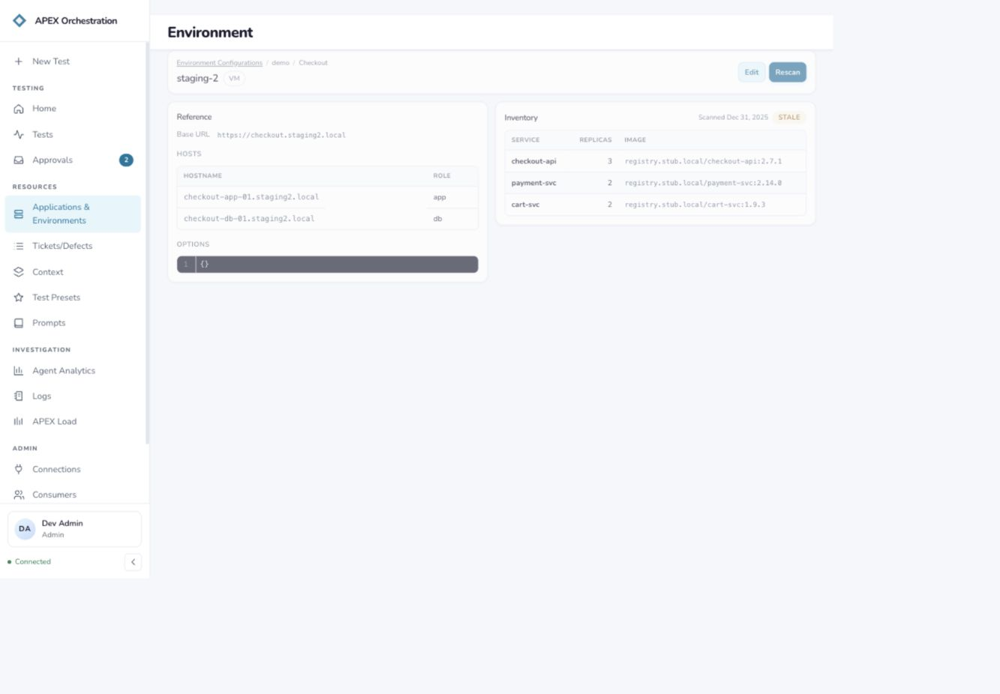

## 03. Tickets: natural-language search — Needs a stronger starting point

Observed: Natural-language and manual modes support different expertise levels. The initial page is a query console with no work items visible; its one saved query is disabled with rebind required. The title Tickets/Defects, section Ticket console, and empty-state term work items compete.

Recommendation: Keep tickets and defects together, with a Type filter or saved views. Use Tickets consistently; present recent or saved results when available, otherwise actionable starter queries. Identify the active tracker connection and provide a clear repair action for unavailable saved queries. A suitable home is Testing because users select work to test and follow up defects.

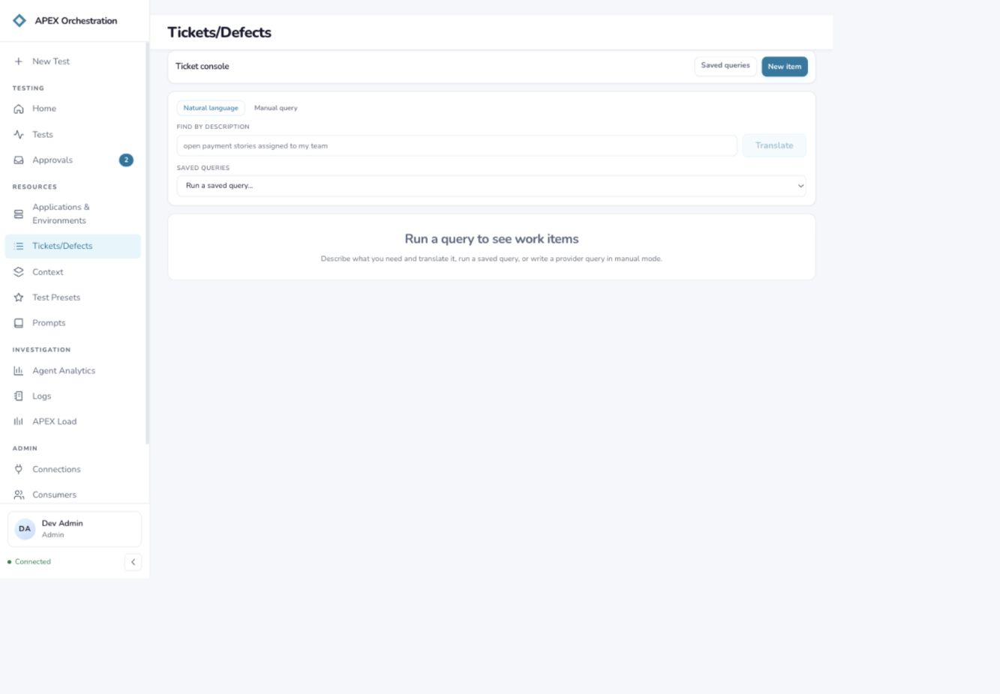

## 04. Saved Queries — Consolidation recommended

Observed: This thin management page is reached through a Saved queries link and returns through Query console. The row shows the stub provider but does not surface the rebind warning seen in the console selector.

Recommendation: Make Search and Saved queries local tabs under Tickets, preserving a direct URL. Show connection health, query purpose, Run and Edit/Reconnect actions inline. A separate top-level destination is unnecessary.

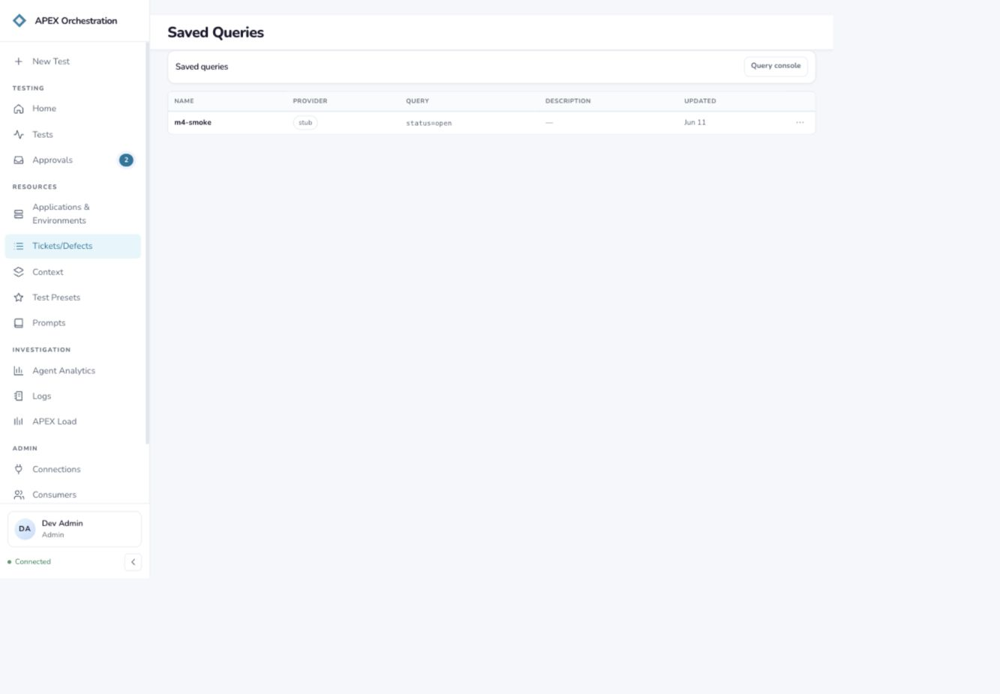

## 05. Context: Summaries — High structural friction

Observed: The default Context tab starts a summary job, while its neighbors hold input documents and generated evidence. The page says it tracks only this session’s submissions and puts results on a run thread. Its two-column empty state squeezes No summary runs yet into a narrow text column.

Recommendation: Rename the durable input library Knowledge & Documents (or Documents if that is its actual scope) and make documents the landing view. Put Generate summary next to selected tickets/documents or inside test setup. Persist summaries with their sources, application and run links; add a Summaries tab only when it contains durable results. Stack the empty-state heading and explanation.

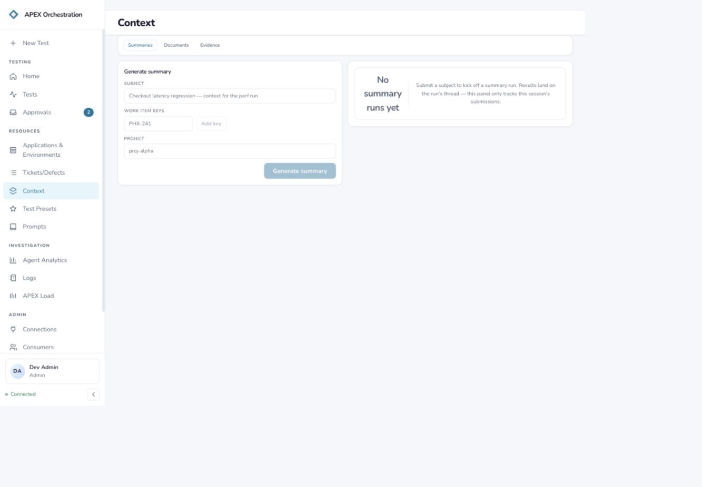

## 06. Context: Documents — Needs retrieval actions

Observed: Search, upload and project/application filters are available. Project and application are free-text inputs with placeholder-only visible labels. Four notes.txt rows have identical type and size and the same displayed day; Delete is the only row action exposed.

Recommendation: Provide named project/application selectors and persistent visible labels. Make the filename open a preview/details view. Add scope, owner or version and full timestamp on demand to distinguish same-named records. Add Use in test and move Delete into an overflow menu. Treat these as source documents, separate from run outputs.

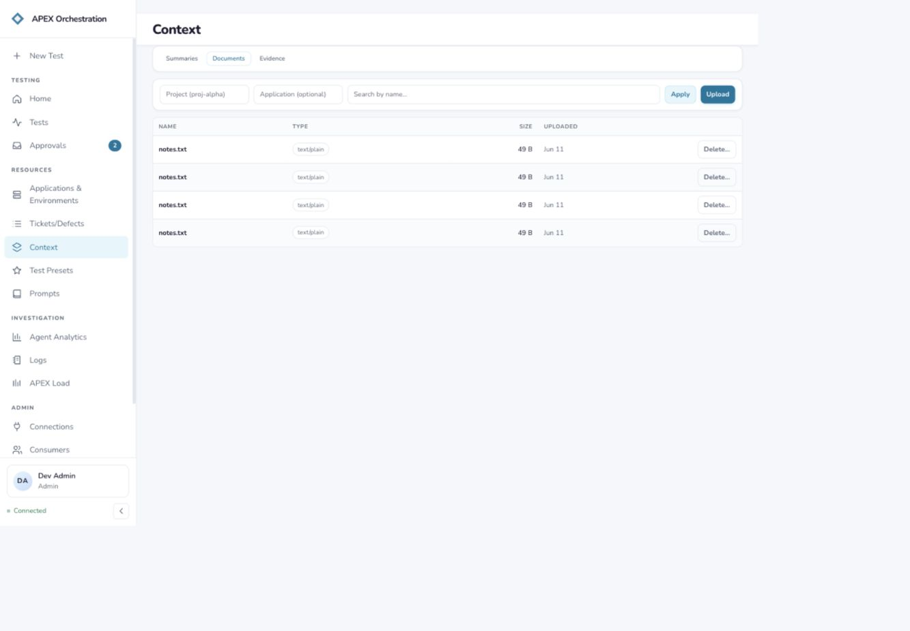

## 07. Context: Evidence — Separation recommended

Observed: The empty state explicitly says evidence accrues from pipeline runs and contains phase outputs, tracker lookups and log findings. Users filter by project and optional thread ID, disconnected from selecting a recognizable test.

Recommendation: Make evidence primarily a tab within a test/run, grouped by phase, with source and timestamp. Offer a cross-run Evidence view under Investigation when needed. Preserve links to contributing documents and tickets; do not merge the input library with execution output.

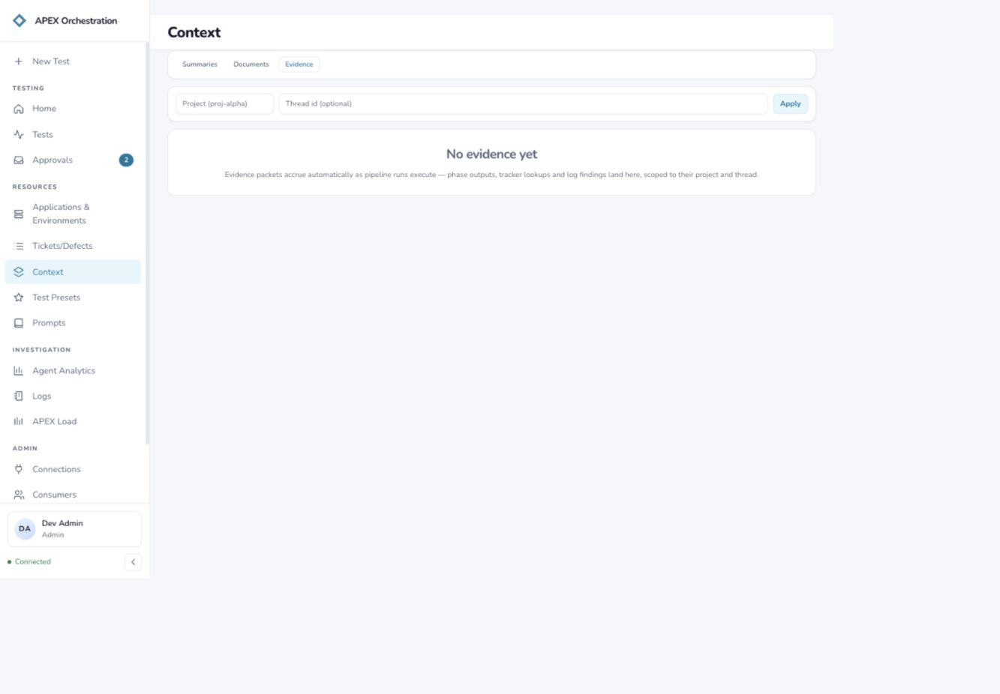

## 08. Test Presets — Blocked by service error

Observed: The sidebar says Test Presets, the header says Golden Configs and the description says Published assistants. The page returned HTTP 500 and exposes raw error JSON; a Retry action is available.

Recommendation: Use Test Presets throughout and explain the outcome: reusable test settings, phases, approvals and prompt versions. Fix the load failure and show a plain error with technical details behind disclosure. Keep presets separate from individual prompts; offer linked prompt versions and Use preset. The successful list/detail experience requires a follow-up capture.

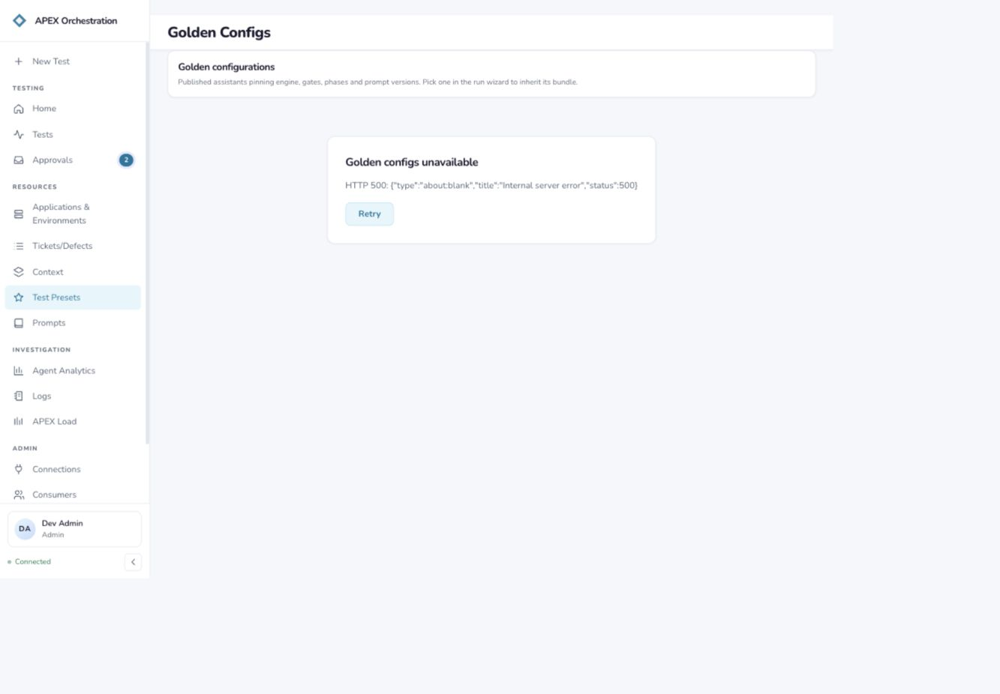

## 09. Prompts catalog — Useful pattern; layout problems

Observed: Search, namespace filters, active version badges and list-with-preview support browsing. Application requirements appear alongside phase instructions. An opaque application key dominates the name; the long key crowds the description and preview header at the captured desktop width.

Recommendation: Retain the catalog and full editor. Use human-readable names and secondary copyable IDs. Make Application requirements and Pipeline prompts explicit categories. Link application requirements from the application workspace. Ensure table columns truncate/wrap deliberately, preview headers can wrap, and narrow layouts stack or open the preview on demand.

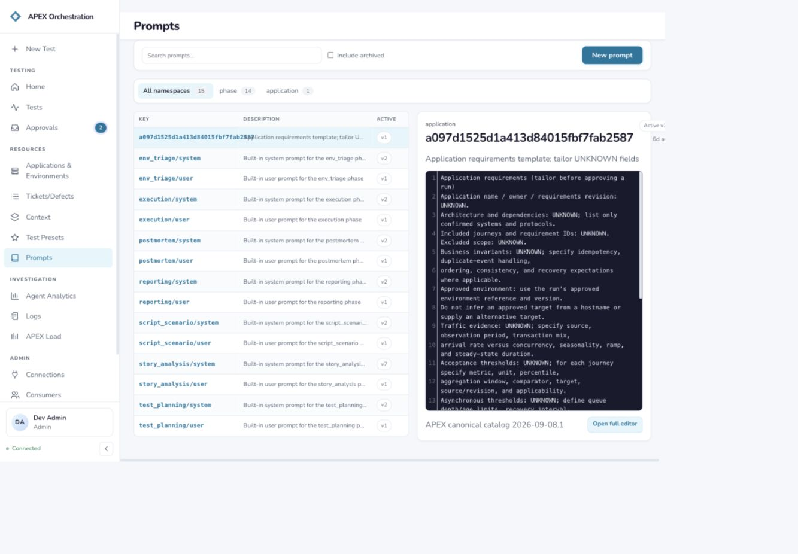

## 10. Prompt content — Mostly sound

Observed: Content and Versions are separated and Test in playground is easy to find. The detail breadcrumb is a namespace plus opaque key, with generic Prompt as the main page title. Archive appears alongside routine authoring actions.

Recommendation: Use a descriptive prompt title with breadcrumb back to Prompts. Keep Content and Versions; add References/Used by to expose related presets and applications. Keep New version primary and move Archive into a secondary menu.

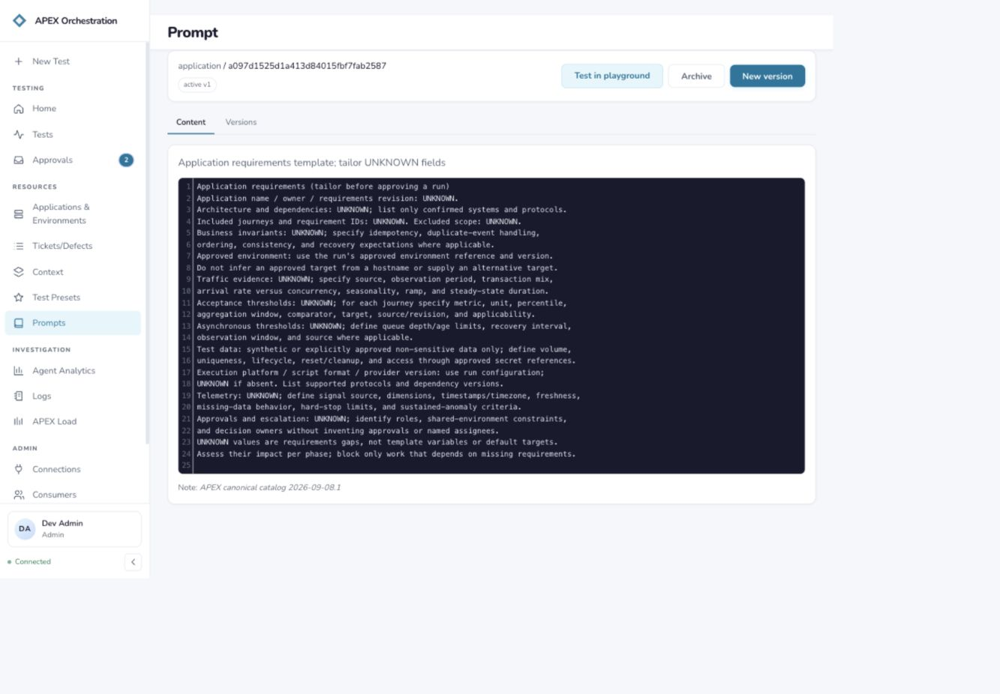

## 11. Prompt versions — Sound separation

Observed: Version history has active status, author, age and a View link. This is a distinct editing/history task that benefits from a local tab rather than another sidebar entry.

Recommendation: Keep this local to a prompt, preserving deep links. Make comparison and active-version consequences clear when multiple versions are present. Only one version was inspected, so rollback and multi-version comparison were not validated.

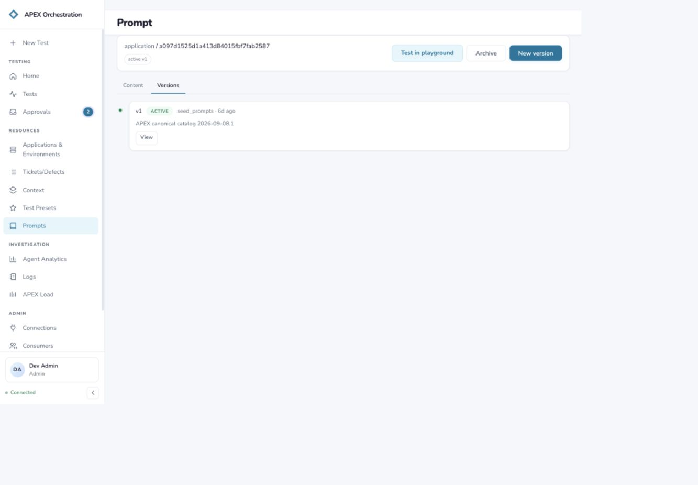

## 12. Prompt playground — Expectation mismatch

Observed: The page discloses that it performs deterministic template rendering rather than model evaluation or tool execution, but the action says Run test. Its empty state mentions live output as a future follow-up and repeats the cramped two-column empty-state layout.

Recommendation: Keep a dedicated workbench reachable from the prompt. Rename the current action Check template or Preview rendered prompt, label the tool Template preview, and present inline rendered output/validation feedback when available. Reserve model-evaluation language for actual model evaluation; preserve the content/version context.

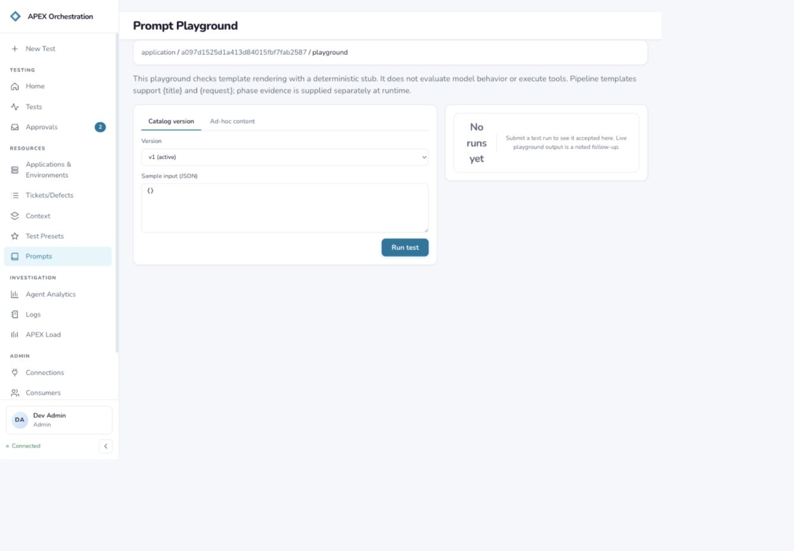

## 13. Tickets: manual query — Useful advanced mode; needs guidance

Observed: Manual mode exposes a free-text Provider field, provider query, page size, Execute and Save query. It shares the same blank results and disconnected saved-query selector.

Recommendation: Retain manual query as an advanced mode within Tickets. Choose a configured connection by name rather than requiring provider text; identify query syntax, retain the query and show saved queries/results in the same workspace. Do not split defects into a second query console.

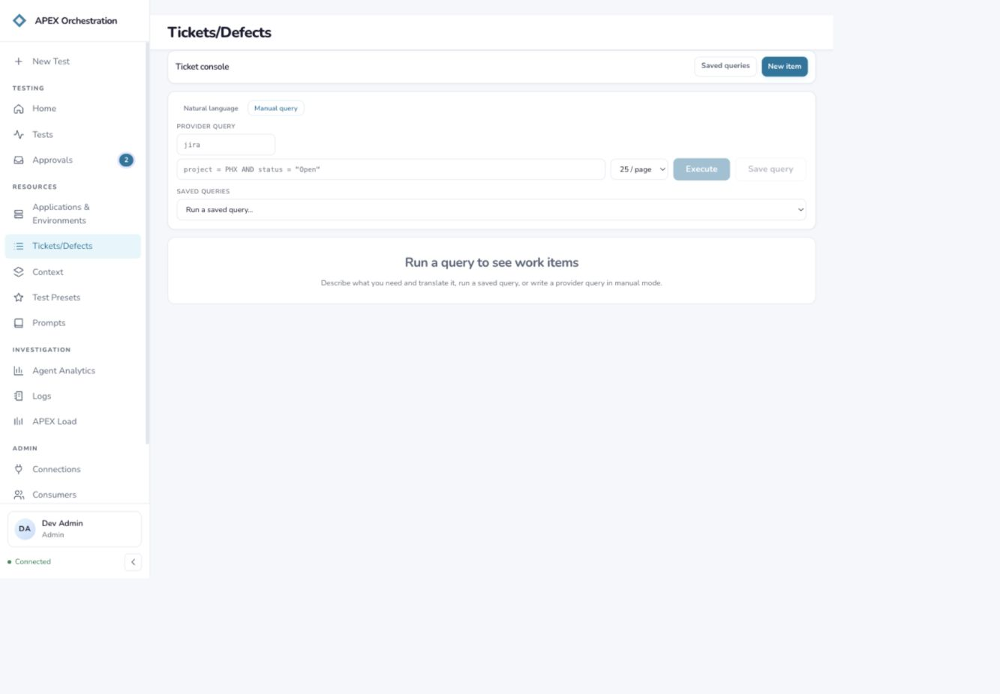

## Evidence limits

Desktop connected app; Dev Admin; 1440 × 1000 viewport. Empty summary/evidence states. Ticket saved query required rebinding and no query was executed. Test Presets returned HTTP 500; successful list/detail not visually verified. No application data was changed. No complete keyboard, screen-reader, contrast, mobile or zoom assessment. See report.html for architecture rationale, priorities and accessibility notes.
