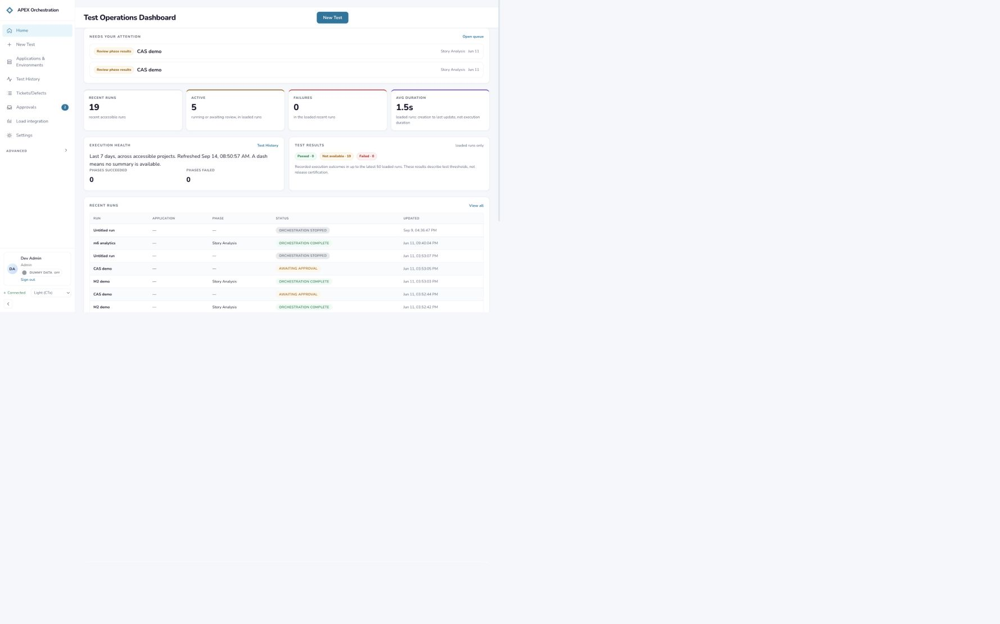
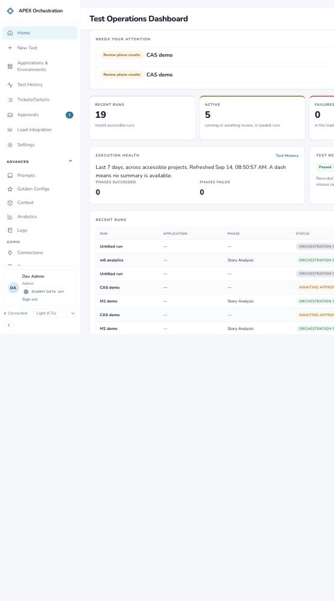
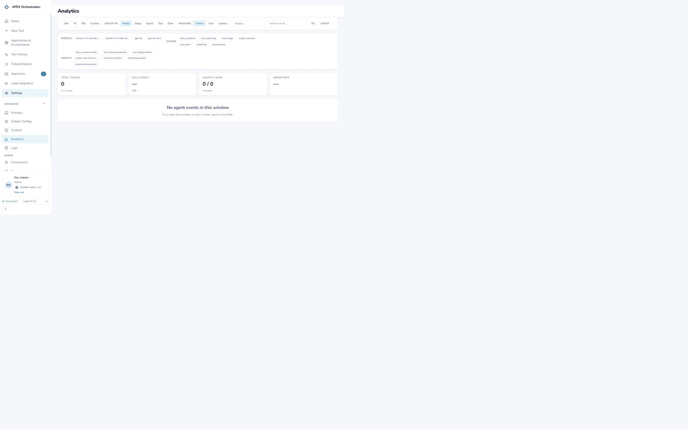
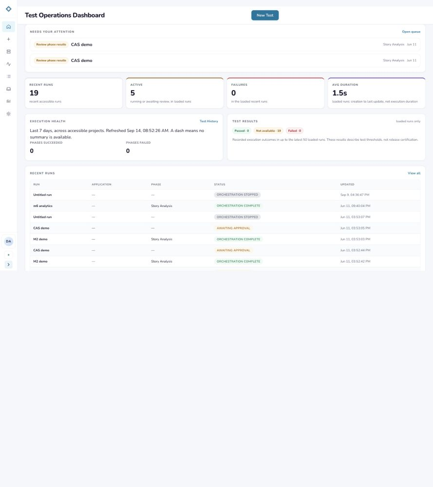
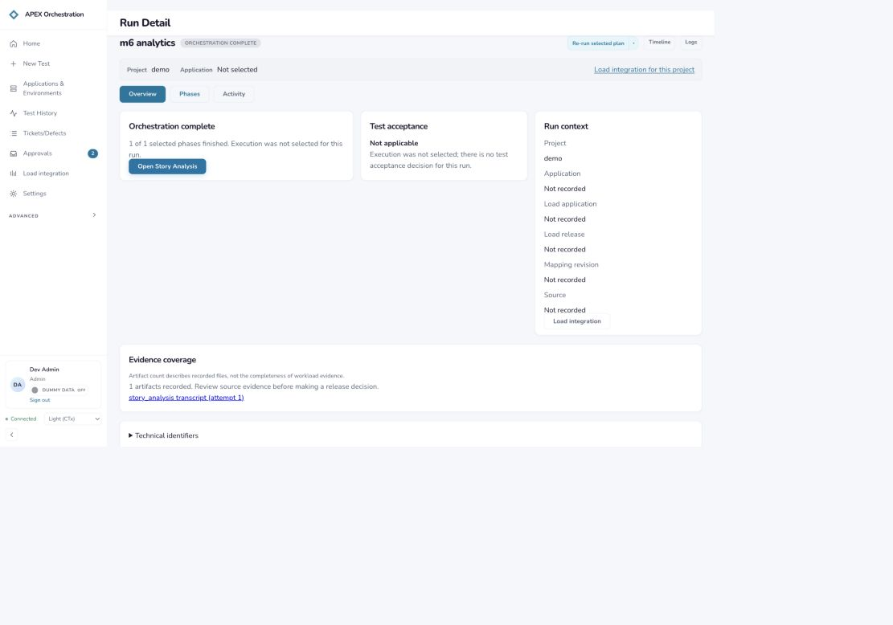
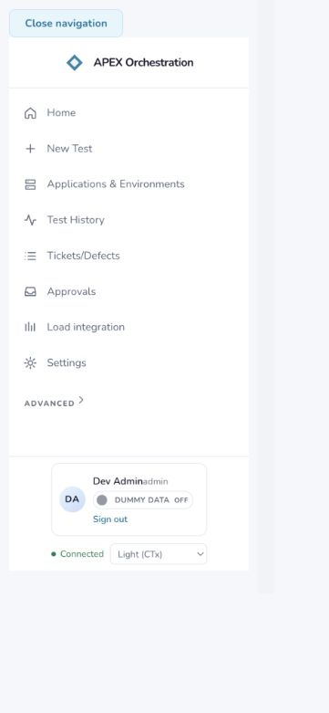
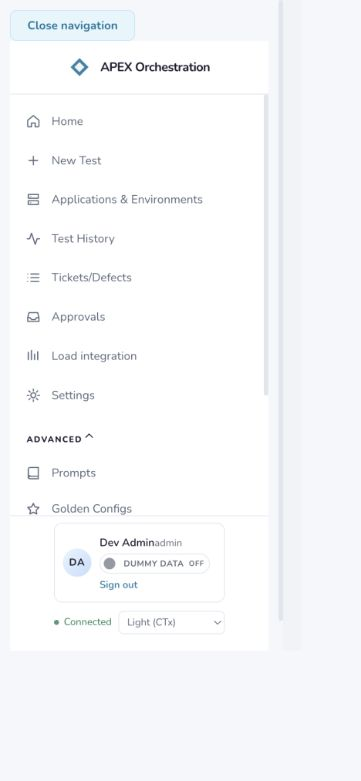
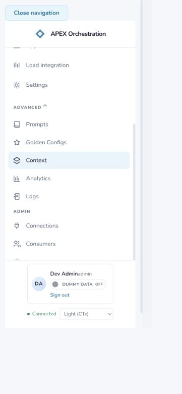

# Left sidebar product design audit

Date: September 14, 2026. Surface: local APEX Orchestration dashboard, authenticated as Dev Admin, Dummy data Off, Light (CTx) theme.

## Verdict

The sidebar provides the main destinations, but its organization follows feature names more closely than an operator's workflow. More seriously, collapse changes which destinations can be reached, run details lose their parent navigation marker, and the Advanced disclosure does not respect a close action on its own routes. These are functional navigation issues as well as design issues.

The strongest existing elements are the expanded approval count, readable labels, persistent account/connectivity footer, and the mobile drawer's keyboard handling. Build on those patterns.

## Scope and method

User goal: move between preparing a test, running/reviewing it, investigating results, and maintaining shared resources without losing location or access to features.

Captured fresh screenshots and inspected the rendered DOM with the Codex in-app browser. Exercised expanded navigation, Advanced, Analytics, sidebar collapse, Test History → a run detail, and a narrow-screen drawer. Checked reverse-Tab containment, Escape/focus return, scrolling, and drawer navigation to Logs. Read the sidebar/router/CSS implementation to corroborate observed behavior.

Responsive overrides were requested at 1440×900 and 390×844. Browser zoom/scaling produced observed CSS viewports of 1600×1000 and approximately 361×781; screenshots retain the actual capture output. Some desktop captures include unused canvas space. Captures 2, 4, and 5 intentionally crop to the navigation and adjacent content. The initial compact capture was rejected and replaced with the expanded desktop state. Temporary viewport override was reset and the sidebar was restored to expanded.

## Captured steps

### 1. Home with expanded sidebar — Usable, weak hierarchy

Eight primary links, a closed Advanced disclosure, and an account/status footer are visible. New Test is easy to find and the approval count conveys pending work. Applications & Environments wraps to two lines, preserving its full label. Preparation, monitoring, integration setup, and personal settings all receive similar visual emphasis.

### 2. Expand Advanced — Functional, poor grouping

Opening Advanced reveals Prompts, Golden Configs, Context, Analytics, Logs, and the Admin group. This combines reusable test inputs, monitoring, and administration behind one generic label. Lower admin destinations extend below the visible navigation area while the footer remains fixed; scrolling is necessary.

### 3. Open Analytics and close Advanced — Confirmed defect

Analytics opens successfully and its navigation item is active. Clicking Advanced to close it leaves `aria-expanded="true"` and the group visible. Source corroboration: the effect depends on a newly allocated `advancedPaths` array every render and sets the group open whenever the current route matches. A user close is immediately undone.

### 4. Close Advanced on Home, then collapse sidebar — Functional gap

The rail shows only the eight primary icons. Advanced and all its destinations disappear, including Analytics, Logs, shared resources, and Admin. There is no rail control to reveal them. Expanding the sidebar restores access, so this is avoidable extra navigation rather than permanent data loss. The two-pending-approvals badge also disappears. The avatar remains visually present but is not an account-menu button; account details, sign-out, and theme controls are hidden.

### 5. Test History → run overview — Confirmed location gap

Opening the existing “m6 analytics” run works, but every primary link loses its active class and `aria-current`. Test History uses exact matching for `/runs`, so detail routes have no parent marker. This is precisely where the sidebar should help orient someone returning from a run, phase, timeline, or artifact.

### 6. Open narrow-screen navigation drawer — Mostly healthy

The drawer has a clear Close navigation control, full destination labels, and an account footer. The approval count is missing despite the same two pending approvals observed on desktop. The identity text visually runs together as “Dev Adminadmin”; the drawer's CSS changes the identity-copy container from flex to block, losing its stacked layout.

### 7. Expand mobile Advanced and test keyboard exit — Functional, crowded

Advanced exposes its links. At this height, only the first few are visible before the fixed footer. Reverse-Tab from Close navigation wraps to Theme inside the dialog. Escape closes the drawer and restores focus to Open navigation. Reopening starts with Advanced closed on this run route, so the previous expansion is not retained.

### 8. Scroll the drawer and navigate to Logs — Healthy access, extra effort

Scrolling reveals Context, Analytics, Logs, and admin links. Clicking Logs completes navigation to `/logs`, closes the drawer, and focuses the main content landmark. The lower links are reachable; the concern is discoverability and the amount of scrolling, not a broken scroll container.

## Prioritized findings and changes

| Priority | Finding | Evidence | Recommended change |
|---|---|---|---|
| P1 | Collapsed mode removes access to all Advanced destinations until the sidebar is expanded. | Steps 2, 4; `Sidebar.css` hides `.nav-advanced-toggle`, while `Sidebar.tsx` conditionally mounts the group. | Keep a labeled More/Resources flyout in the rail, or make each group available as an accessible icon menu. The same destinations must remain reachable in expanded, collapsed, and drawer modes. |
| P2 | Run details have no active parent navigation item. | Step 5; `/runs` uses `end: true`. | Keep Tests/Test History selected for `/runs/:id`, phases, timeline, artifacts, and compare; explicitly exclude `/runs/new` so New Test is the only selected entry there. |
| P2 | Advanced immediately reopens after the user closes it on an Advanced route. | Step 3; effect dependency re-created every render. | Auto-open on route changes into the group, then honor manual close until the route changes again. Keep the active group's marker visible when closed. |
| P2 | Approval urgency disappears in collapsed and mobile navigation. | Steps 1, 4, 6; badge hidden by collapsed and ≤768px CSS. | Preserve a small count/dot on the icon and include the pending count in its accessible name. Retain the normal badge in the full-width drawer. |
| P2 | Routine resources and investigation tools are buried under “Advanced,” while unrelated primary destinations are flat peers. | Steps 1–3, 7–8. | Organize by Testing, Resources, and Administration; place Analytics and Logs where results investigation is discoverable. Give New Test a dedicated action position. |
| P3 | Sidebar labels do not consistently describe the destination or the breadth of content. | Steps 1–3, 5, 8; Test History contains current/awaiting runs, Analytics shows agent token/latency data, and Logs is a separate diagnostic surface. | Consider Tests, Work Items, Test Presets, Agent Analytics, and APEX Load. Use short descriptions/tooltips where a rename alone cannot explain the scope. Preserve domain meaning rather than relabeling token analytics as test results. |
| P3 | Footer uses significant vertical space and loses identity layout on mobile; the rail avatar does not offer account actions. | Steps 2, 4, 6–8. | Make the avatar an accessible account menu with role, theme, and sign-out. Keep connectivity compact and move the development data switch into a clearly identified development area. Restore stacked name/role layout in the drawer. |

P1 means a navigation access problem worth fixing first. P2 means a material usability or behavior issue. P3 means clarity or polish with lower urgency.

## Proposed information architecture

Preserve the existing destinations and route permissions; reorganize their presentation:

- **New Test**: dedicated primary action at the top.
- **Testing**: Home, Tests, Approvals with count; Test Cycles alongside Tests when its existing feature flag is enabled.
- **Resources**: Applications & Environments, Work Items, Context, Test Presets, Prompts.
- **Investigation**: Agent Analytics, Logs, APEX Load.
- **Administration**: Connections, Consumers, System, restricted to admins as today.
- **Footer**: account/preferences menu and connectivity state.

On the expanded sidebar, use visible group labels with optional disclosures. On the rail, provide accessible group flyouts instead of removing groups. On mobile, use the same order and keep the approval count. Consider abbreviating the visible Apps & Environments label only if the full meaning remains available; the existing wrapped label is preferable to truncation.

This is a proposed grouping, not a claim that these names have been user-tested. In particular, APEX Load combines execution operations and integration context; validate its placement with the people who use it most.

## Accessibility findings and limits

Confirmed: a Primary navigation landmark, named links even in the icon rail, a skip-to-content link, an `aria-expanded` disclosure, a named mobile dialog, reverse-Tab containment at the boundary, Escape return to the trigger, and main-landmark focus after drawer navigation. The current drawer reveals full text labels rather than relying on icons.

Confirmed gaps: missing current-location semantics on run details and missing pending-approval information in collapsed/mobile navigation. Hiding Advanced also removes its controls from the keyboard path. The footer's small text and the rail's title-only explanations warrant further usability checks.

Not certified: full screen-reader behavior, contrast ratios across themes, every Tab stop, browser zoom at 200–400%, touch-target measurements, reduced-motion behavior, and all role/feature combinations. The session was an admin session; operator/viewer navigation and the feature-gated Test Cycles entry were checked in source only. Every primary/advanced destination exists in the router, but this audit did not execute each destination's complete workflow. No launches, approvals, sign-outs, data-mode changes, or account mutations were performed.

## Implementation acceptance criteria

1. Every permitted destination is reachable in expanded, collapsed, and mobile modes.
2. A run detail, phase, timeline, artifact, or compare view retains its Tests parent marker; New Test does not highlight that parent simultaneously.
3. Advanced/group disclosure state changes when clicked and is not overwritten by unrelated rerenders.
4. Pending approval count remains perceivable and available to assistive technology at every navigation size.
5. Keyboard users can open/close flyouts and drawers, escape them, and return to the correct trigger; navigation focuses the new content.
6. Drawer name and role remain visually separated, and lower destinations remain reachable at short heights.
7. Role restrictions and feature flags remain unchanged by regrouping.

## Source corroboration

- Sidebar destinations, exact matching, disclosure effect, role/feature conditions: `apps/dashboard/src/components/layout/Sidebar.tsx`.
- Rail/disclosure/badge hiding and footer styles: `apps/dashboard/src/components/layout/Sidebar.css`.
- Drawer mounting, focus transfer, and styling: `apps/dashboard/src/components/layout/AppShell.tsx` and `AppShell.css`.
- Destination registration: `apps/dashboard/src/routes/router.tsx`.

## Implementation update

The audited sidebar changes were implemented on September 14, 2026:

- New Test is now a dedicated top-level action; the remaining destinations are grouped under Testing, Resources, Investigation, and role-restricted Admin.
- All permitted destinations remain as links in the collapsed rail and the mobile drawer; the drawer retains its group labels.
- Tests remains selected for run details, phases, timelines, artifacts, and compare views, while New Test is independently selected only at `/runs/new`.
- The approval count remains visible in the rail and drawer, and its accessible name includes the pending count.
- The account identity is now an accessible control that reveals development data, theme, and sign-out actions; the name and role retain a stacked layout in the drawer.

Focused navigation tests, type checking, and visual checks at desktop and 390 × 844 mobile viewport were run after this update.
