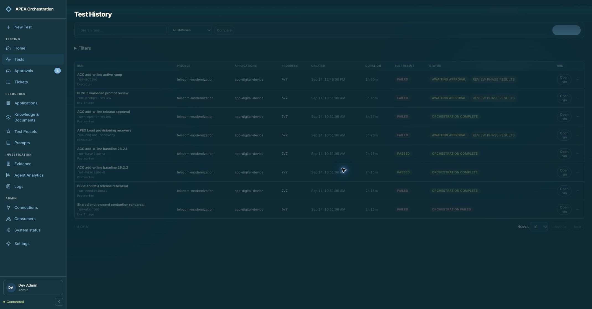
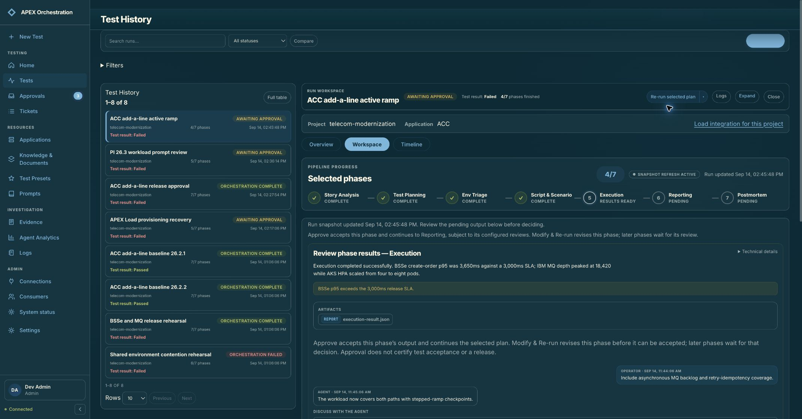
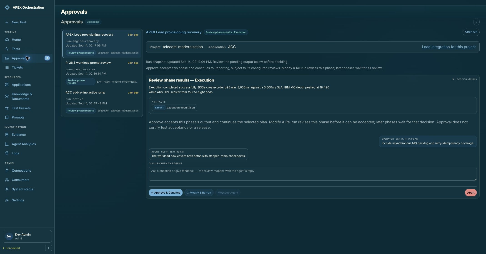
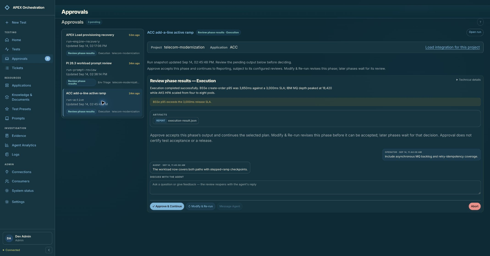
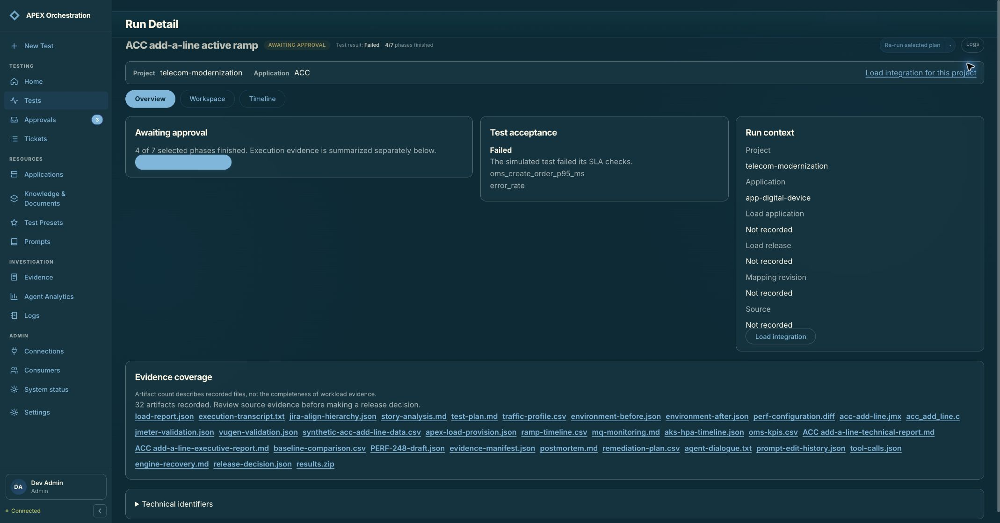
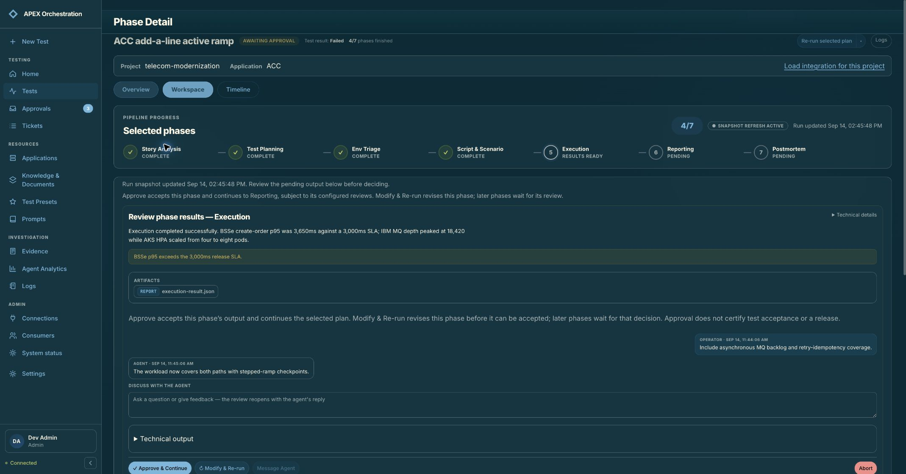
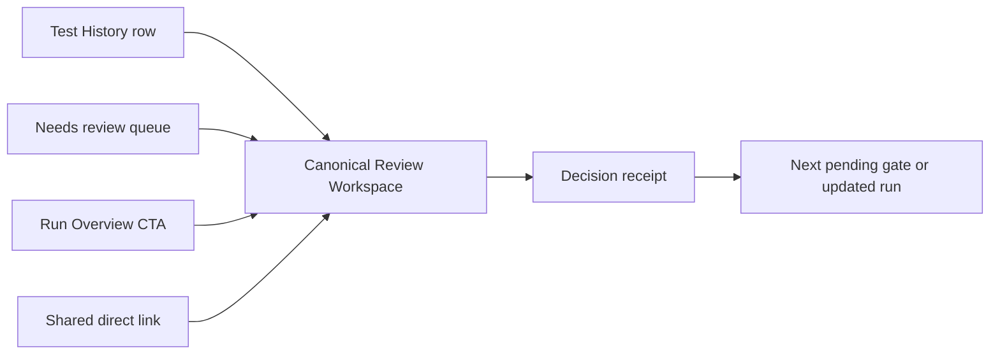

# Test History & Approvals workflow audit

**Audit date:** 2026-09-14  
**Scope:** Test History, Approvals, Run Overview, and the phase-level approval surface  
**Operator goal:** Find a run that needs review, understand why it stopped, make a safe decision, and continue to the next item without losing queue context.

## Verdict

The product already has the right underlying building blocks, but it presents two different approval experiences for the same gate. Test History opens the full Run Workspace at the pending phase, while Approvals opens a reduced preview. The reduced view omits the run result, pipeline progress, phase snapshot, evidence coverage, and supporting reasoning that operators can see through the other path. `Open run` then sends the operator to Run Overview rather than the pending decision, adding another navigation step.

Keep approval triage as a distinct list mode, because its oldest-first queue and keyboard navigation are useful. Consolidate the decision surface into one canonical **Review Workspace**. Every entry point should open the same route, context, wording, and actions for a gate; only the left-hand list or filter should change.

## Current journey

### 1. Test History — needs attention

**Health: Needs improvement**

The table makes pending runs visible and provides both `Review phase results` and `Open run`. Those actions lead to different depths of the same run, so the operator must know which one contains the decision context. Repeated `Review phase results` labels also do not identify the associated run or phase for assistive technology.

### 2. Test History — pending review in Run Workspace

**Health: Strong foundation**

This is the richest approval experience. The selected run remains in the history list, while the workspace shows orchestration status, the failed test result, phase progress, pipeline position, the gate, operator summary, evidence, logs, and reasoning. The main opportunity is to order the information around the decision and keep the decision controls available while supporting detail scrolls.

### 3. Approvals — inbox and compact preview

**Health: Needs improvement**

The queue supports oldest-first triage and keyboard selection, which should be retained. The right pane uses a compact gate presentation and omits important context available in Run Workspace. The page also repeats the `Approvals` heading. The action label `Approve & Continue` can be read as approving the failed test or release, although nearby explanatory copy says the action only accepts the current phase output.

### 4. Approvals — same run, different detail level

**Health: High decision risk**

The same run and gate shown in step 2 now have less surrounding information. Queue selection is held in local state and the URL remains `/approvals`, so browser history, refresh, and shared links do not reliably preserve the selected decision.

### 5. Open run from Approvals

**Health: Poor continuity**

`Open run` lands on Run Overview. The overview restores the run status, failed result, and evidence list, but the operator must use a second `Review pending decision` action to return to the approval. In Solarized Dark, the large primary review action appears to have unreadable text; this should be verified with measured theme contrast during implementation.

### 6. Review pending decision from Run Overview

**Health: Strong content, weak path**

The operator reaches the full phase workspace again, but has lost the Approvals queue context. This confirms that the full Run Workspace is the appropriate shared decision surface and that the extra Overview stop does not add necessary information.

## Proposed information architecture

Use one Test Operations destination with two list modes:

- **All runs** — the current Test History list.
- **Needs review** — the current approval queue, including count, wait age, oldest-first ordering, filters, and keyboard navigation.

The sidebar should expose one `Tests` item with the pending-review badge. `All runs` and `Needs review` are modes within that destination. On wide screens, the left pane changes between those modes while the right pane remains the same Review Workspace. On narrow screens, the list and review can be separate screens backed by the same canonical gate URL.

Suggested canonical route:

`/runs/:threadId/reviews/:interruptId`

The route should identify both the run and the exact pending gate. List mode and filters can remain query parameters, for example `?source=queue&sort=oldest`. All four entry points should resolve to this route. Browser back/forward, refresh, and shared links will then preserve the operator's exact decision context.

## Review Workspace structure

Order the page around the questions an operator must answer before acting.

1. **Sticky run header** — run title and short ID, project/application, waiting age, orchestration status, test result, and phase progress. Keep orchestration state and test outcome visually separate.
2. **Section navigation** — Decision, Overview, Workspace, and Timeline. Decision is selected when a gate is pending; the other sections remain available without leaving the run shell.
3. **What needs your decision** — phase, gate type, blocking finding, errors and warnings, and the reason automation stopped.
4. **What happens next** — the next phase or rerun, what remains blocked, and the effect of each decision.
5. **Key evidence** — KPI summary, evidence coverage, source freshness, warnings/errors, and the most relevant artifacts. Show enough to decide before requiring a tab change.
6. **Discussion and decision history** — operator notes, agent responses, prior decisions, and timestamps.
7. **Supporting detail** — Phase details, Pipeline log, Agent reasoning, and raw JSON as progressive disclosure.
8. **Sticky decision bar** — `Accept phase output & continue`, `Request changes`, and `Ask agent`. Move `Abort run` to a clearly separated danger action. Place the text “Accepts this phase output; it does not approve the test result or a release” directly beside the primary action.

After an action, keep the operator in the same shell and show a receipt with the actor, timestamp, decision, note, and resumed phase. In Needs review mode, offer the next gate immediately while preserving a way to inspect the completed decision.

## Required information before a decision

| Information | Current Test History path | Current Approvals path | Proposed workspace |
|---|---:|---:|---:|
| Run title and ID | Yes | Yes | Always |
| Project/application | Yes | Yes | Always |
| Gate phase and type | Yes | Yes | Always |
| Waiting age/source freshness | Partial | Yes | Always |
| Orchestration status and progress | Yes | No | Always |
| Test result | Yes | No | Always, visually separate |
| Blocking findings, warnings, errors | Yes | Partial | Always |
| Evidence coverage and key artifacts | Yes | Partial | Always |
| Effect of the decision | Partial | Copy below actions | Adjacent to actions |
| Discussion and decision history | Yes | Yes | Always |
| Logs, reasoning, and raw output | Yes | No | Progressive disclosure |

## Priority recommendations

### P0 — one decision surface

- Route Test History, Approvals, Run Overview, and direct links to the same gate-specific Review Workspace.
- Stop presenting approval actions in the reduced compact preview unless it contains the same required decision information.
- Use `Accept phase output & continue` and place its scope beside the action so it cannot be mistaken for approving a failed test or release.

### P1 — preserve context and state

- Make the selected queue item URL-backed.
- Keep All runs or Needs review in the left pane while the operator reviews a gate.
- Add a sticky decision bar and a clear post-decision receipt with the next queue item.

### P2 — navigation and accessibility cleanup

- Treat Timeline, Overview, Workspace, and Decision as sections of one run shell.
- Remove the duplicate Approvals heading.
- Give row actions and queue options accessible names that include the run and phase.
- Verify primary action, link, focus, and disabled-state contrast in every theme, including Solarized Dark.

## Acceptance criteria

- Opening the same gate from Test History, Needs review, Run Overview, or a shared link shows the same status, result, evidence, discussion, and actions.
- A pending decision is reachable in one action from every list or run entry point.
- Action wording and adjacent copy distinguish accepting phase output from approving a test result or release.
- Browser back/forward, refresh, and shared links preserve the selected gate and list mode.
- A completed action produces a durable receipt and an obvious path to the next pending gate.
- Queue options and actions announce the run title, phase, and gate to assistive technology.
- Action text and focus indicators remain readable in every supported theme.

## Evidence limits

This audit used the current local demo state in an existing authenticated Chrome profile and did not submit an approval, request changes, ask the agent, or abort a run. The screenshots document the current run only. Keyboard shortcuts and semantic roles were inspected through the rendered UI and source, but a complete screen-reader, touch, responsive reflow, and measured WCAG contrast audit was outside this pass.
