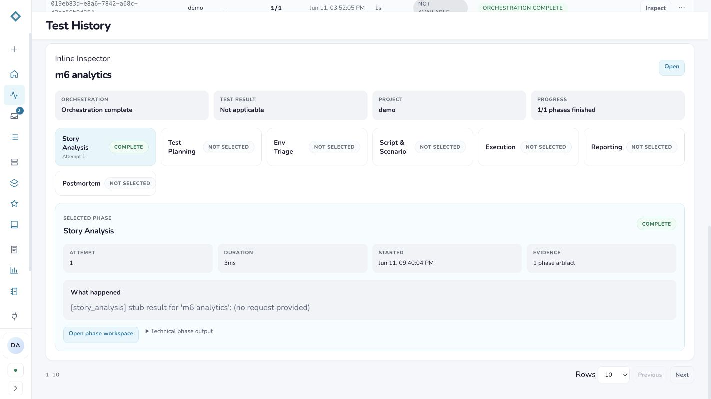
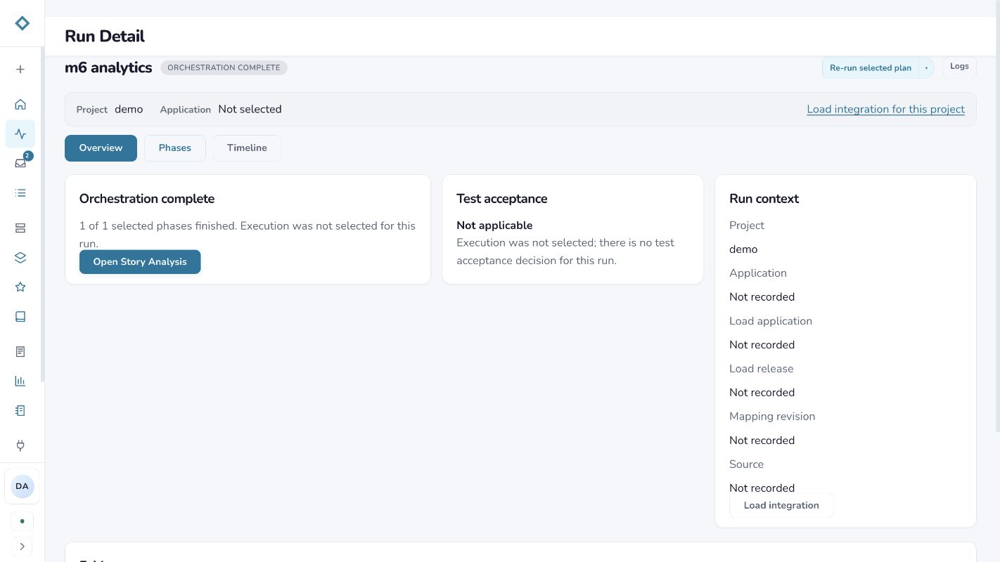
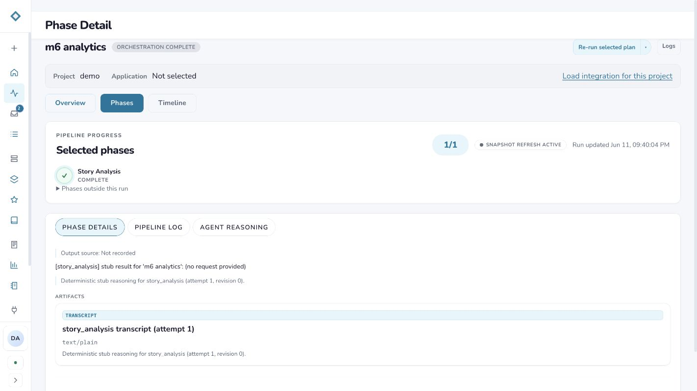
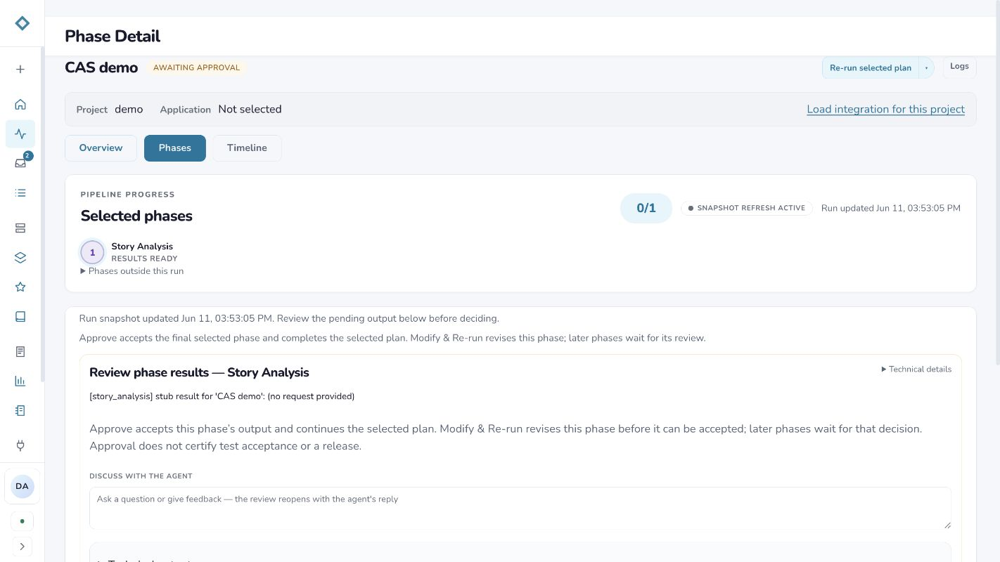
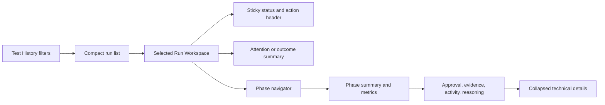

# Test History: Inspect and Run Detail consolidation audit

Date: 2026-09-14  
Mode: Combined UX and accessibility audit  
Scope: Test History, Inline Inspector, Run Overview, Phase Detail, and approval state

## Decision

Consolidate the two entry points into one **Run Workspace**. The current inline inspector and Run Detail use the same run data and repeat status, project, progress, phase state, and summary information. Operators should not have to decide whether to “Inspect,” click the run title, choose “Open overview,” click “Open,” or click “Open phase workspace.”

The only reason to retain two presentations is screen density: Test History supports scanning and comparing many runs, while a selected run can contain live state, approvals, logs, reasoning, artifacts, rerun controls, and technical output. Solve that with progressive disclosure and responsive presentation, while using one component, information hierarchy, and URL-backed selection state.

## Audit scope

This audit reviewed a completed run and an awaiting-approval run in the live local application. It also compared the implementation boundaries in `RunsListPage`, `RunDetailPage`, `RunOverview`, and `PhaseWorkspace`.

## User goal and accessibility target

An operator should be able to find a run, understand its outcome, identify anything requiring attention, inspect any phase, and take the next permitted action without learning two overlapping run-detail models. The flow should preserve keyboard position, expose selection state semantically, and remain usable at narrow widths and high zoom.

## Flow review

### 1. Test History entry — Health: Needs improvement

The run title opens Run Detail, the Inspect button opens a second experience below the table, the overflow menu contains “Open overview,” pending-gate chips open Run Detail, and compact cards repeat title and Inspect actions. These competing paths are visually similar but lead to different levels of detail.

### 2. Inline Inspector — Health: Mixed

The redesigned inspector now gives operators a useful snapshot, readable phase names, phase metrics, a narrative summary, attention items, and collapsed technical JSON. The problem is placement: it appears after the entire table and pagination, far from the initiating row. Its “Open” and “Open phase workspace” controls reveal that it is an intermediate destination rather than a complete task surface.

### 3. Run Overview — Health: Good content, duplicated hierarchy

Run Overview provides a clear status, progress explanation, acceptance outcome, scope, and links into the phase. Much of its header and summary repeat the inspector. The separate page title also changes from “Test History” to “Run Detail,” weakening the operator’s sense of place.

### 4. Phase Detail and approvals — Health: Strong task support, weak transition

Phase Detail contains the content that makes this an operator workspace: selected phase progress, live refresh state, output, artifacts, logs, agent reasoning, prompts, rerun controls, and review actions. The awaiting-approval state is especially important and cannot be completed in the inline inspector.

## Strengths

- The run list is efficient for scanning status, outcome, progress, recency, and duration.
- The inline inspector uses operator-readable language and keeps raw JSON behind a disclosure.
- Run Detail already has URL-addressable overview, phase, timeline, and artifact states.
- The phase workspace supports real operational tasks: approvals, reruns, logs, reasoning, evidence, and prompts.
- Statuses pair color with text, so meaning does not depend on color alone.

## UX risks

- Operators must choose among several labels for the same object: Inspect, Open, Open overview, Open phase workspace, and the run-title link.
- The inline inspector is spatially detached from the selected row and can appear below the viewport.
- Summary fields repeat across the inspector, detail header, overview cards, and phase hero.
- The lightweight inspector cannot complete an approval or other run action, so it becomes a predictable extra step.
- The transition from a list to a full-page destination discards the visible filter and scan context.
- Generic labels such as “Open” do not state what will open.

## Accessibility risks

- Inspector phase buttons visually indicate the active phase but do not expose a selected state such as `aria-selected` or `aria-pressed`.
- Opening content far below the initiating control makes the state change easy to miss for keyboard and magnification users.
- Focus remains on the Inspect button instead of moving to the newly opened inspector heading.
- Multiple controls with overlapping outcomes increase cognitive load and make action names less predictable.
- A future side workspace must be a non-modal complementary region; it should not trap focus and must return focus to the initiating row when closed.

This is a source- and browser-based review, not a full assistive-technology or WCAG conformance test.

## Recommended integrated design

### One entry point

Replace **Inspect**, title-link navigation, and **Open overview** with one primary action: **Open run**. The run title and action may both invoke it, but they must produce the same selected-run state. Keep Re-run and Copy run ID in the overflow menu.

Pending approval chips should open the same Run Workspace with the required phase selected and the decision card in view.

### One Run Workspace, two responsive presentations

On wide screens, selecting a run changes Test History into a master-detail layout:

- The left pane becomes a compact run list with title, project, outcome, orchestration status, progress, and updated time.
- The right pane renders the Run Workspace and uses about two-thirds of the content width.
- Closing the workspace restores the full table and returns focus to the selected row.
- **Expand** opens the same workspace full width; it is a layout change, not a different information destination.

On compact screens and at high zoom, **Open run** uses the full page. The content, labels, state, and component tree remain the same.

### Workspace information hierarchy

1. **Sticky run header** — run title, orchestration status, test result, progress, project/application, last update, and a close/back control. Show the current required action as the primary control; keep Logs, Re-run, and Copy ID secondary.
2. **Attention summary** — show approval requests, errors, warnings, or stale-data notices first. When no action is required, show the operator-readable “What happened” summary.
3. **Phase navigator** — show selected phases by default with status and attempt. Put phases outside the run behind the existing disclosure. Use proper tab or listbox selection semantics and arrow-key navigation.
4. **Selected phase workspace** — combine phase status, attempt, duration, start time, evidence count, summary, and warnings with the existing approval, artifact, log, reasoning, and prompt content.
5. **Progressive technical detail** — keep raw phase JSON, prompt configuration, and low-level metadata collapsed until requested.
6. **Run-level navigation** — retain Overview, Workspace, and Timeline as URL-addressable states. Rename Phases to Workspace because it contains decisions and operational tools beyond phase navigation.

### Suggested desktop structure

### Interaction and URL behavior

- Store the selected run and selected phase in the URL so browser Back, refresh, copy-link, and deep links work.
- Fetch detail data only for the selected run and reuse the existing run-state query cache.
- Reuse the same Run Workspace component in split and full-width layouts to prevent content drift.
- Move focus to the workspace heading after opening; announce status refreshes through the existing polite live region.
- Preserve Test History filters, sort, page, and scroll position when the workspace closes.

## Recommended delivery order

1. Extract a shared Run Workspace shell from `RunDetailPage` and reuse the existing `RunOverview` and `PhaseWorkspace` content.
2. Replace the Inline Inspector with the shared workspace in a master-detail layout.
3. Replace all competing labels with Open run; retain Expand as an optional layout control.
4. Add URL-backed selected run/phase state, focus management, and selected-state semantics.
5. Verify completed, failed, running, awaiting approval, schema-drift, empty-artifact, compact, keyboard, and 200% zoom states.
