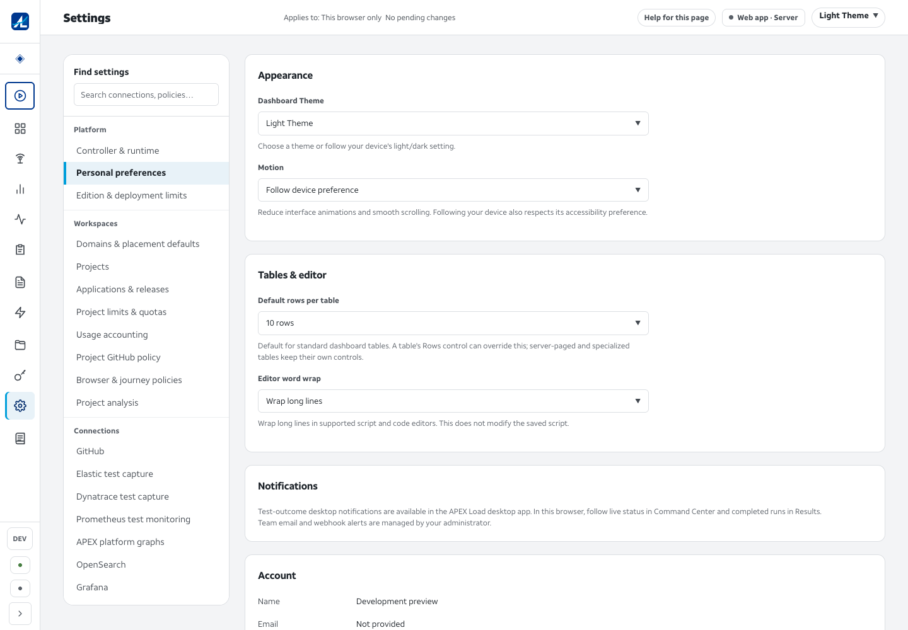
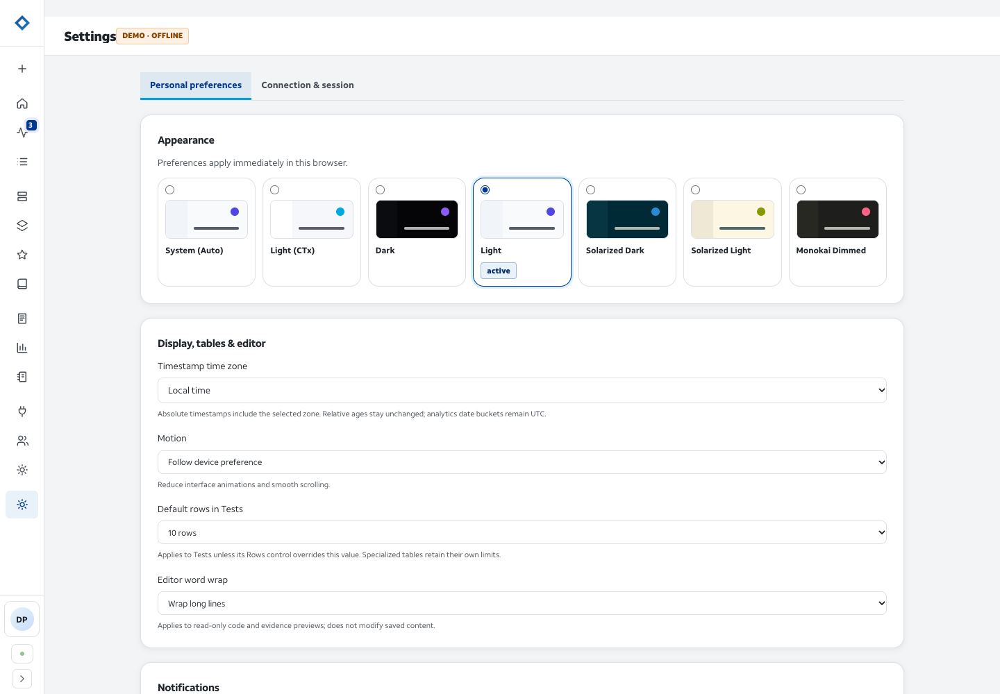

# Usability and presentation remediation — 17 October 2026

Implemented in **APEX Orchestration**, starting from integrated main `253d137`. APEX Load supplied the reference fonts and shell measurements; its source was not modified. This pass follows the re-scoped five-workstream plan rather than repeating changes already verified on the earlier branch.

## Delivered behavior

| Workstream | Result |
|---|---|
| 1 — compact phase targets | The runs grid retains its seven 12 × 6px visual segments as one non-interactive `role="img"` with the complete phase sequence. No compact segment is focusable, even if a caller supplies `onSelect`. The existing row control opens the run; full-size workspace phases retain keyboard navigation. |
| 2 — remaining re-review defects | Already corrected on the starting baseline: authenticated approval attribution, grouped native request rejection mapping, and honest demo activity copy. The previous [native HTTP receipt](holistic-ux-native-rereview-2026-10-17.json) and [re-review correction](holistic-ux-remediation-2026-10-17.md#independent-re-review-corrections) remain the evidence for the server changes. This pass changes no backend code. New browser checks retain the demo-copy and concise-announcement assertions. |
| 3 — presentation tail | Run context and scope both resolve the application name; the full application ID is copyable behind Technical identifiers. Reasoning digest, Tool calls, Resolved prompt and Operator dialogue now use sentence case. The earlier chart contrast and concise queue announcements remain covered by rendered checks. |
| 4 — unverified finding triage | Every original ID in the five sweeps has a disposition and evidence in the two ledgers below. Cheap remaining defects were corrected: duplicate body headings, wizard validation terminology, duplicate pulse animation, consumer-name deletion confirmation, connection Delete… copy, prompt activation disclosure and distinct native-execution/dashboard-run receipt identities. Larger capability gaps are explicitly scoped as follow-ups. |
| 5 — Load presentation parity | The project owner approved bundling ATT Aleck Sans. Four identical Load font files replace Inter, Nunito and IBM Plex assets; all six themes inherit Load's exact sans and system-mono stacks. The shared page title matches Load at 19px / 850. Desktop starts at the 64px rail; expansion is a 240px focus-contained overlay with outside/Escape dismissal and focus restoration. Existing preferences, named destinations, the review count and mobile drawer are preserved. The four higher-contrast calendar text tokens remain documented domain exceptions. |

The [UX contract](../design/APEX_UX_CONTRACT.md) now records the fonts, approval, sidebar behavior, compact-strip boundary and calendar exceptions so these choices are reviewable compatibility requirements.

## Complete finding inventory

- [Interface ledger](usability-triage-interface-2026-10-17.md): all 17 CON, 17 A11Y and 16 AGT IDs.
- [Workflow/correctness ledger](usability-triage-workflows-2026-10-17.md): all 27 ARE and 23 COR IDs.

The inventory was compared with the original five documents by ID: **100 distinct findings — 95 closed, 4 partially open, 1 not testable here**, with no omissions or duplicate disposition rows. A closed finding means its reported behavior is supported by the cited implementation and checks; it does not certify an entire route or external integration. The four partial findings are ARE-09, ARE-16, ARE-21 and ARE-27. The workflow ledger defines priority, scope and acceptance checks for authoritative project/consumer names, Cycles dispatch and bounded list progress. A11Y-17's run calendar cannot be rendered in this build.

## Rendered parity evidence

Both captures show Personal preferences at 1440 × 1000 in the shared `light` theme with the rail collapsed. They use the same brand face, exact font stacks and 19px / 850 Settings title. Product-specific layout remains different: Load has a settings destination list, while Orchestration has section tabs and theme cards.

| APEX Load reference | APEX Orchestration |
|---|---|
|  |  |

The Load capture used the existing local controller reporting `main-cd1d4a100`. The Orchestration capture used this worktree's production bundle. Browser font checks load all four actual local faces in every theme and reject obsolete font assets in the bundle. Screenshots were visually inspected; no rendered font match was inferred from token text alone.

## Verification and review

The production browser suite covers real interaction with the built bundle. Connected cases use explicit HTTP fixtures for role/scope and seeded uncommon tool outcomes; those fixtures are not evidence of external provider execution. The route census visits **38 concrete cases** spanning every declared route pattern, legacy preset/review redirects and the unknown-route fallback. Configured Cycles workflows receive separate action tests; its demo route honestly remains unconfigured.

Review and fix cycles caught a sidebar restoration race: a delayed second focus operation could undo the user's next Tab after dismissal. The fix leaves ordinary focus restoration to Dialog and uses a fallback only when dismissal leaves focus on the document body, including stored-expanded first loads. A deterministic regression flushes deferred frames after the user has tabbed away. Dirty-review navigation also verifies cancellation, retained drafts and return navigation through the sidebar.

The same review found that a backdrop's default mousedown action could undo Dialog's restored focus. The shared backdrop now prevents that default only for the top dialog's own backdrop. Nested controls and underlying dialogs are unaffected; full-click and immediate-next-Tab tests cover the primitive.

Two original findings still had residual defects despite passing broader tests. COR-04's overview used “Not applicable” for omitted execution; it now uses “Not available” consistently with the header and explains omission separately. ARE-24's old added/deleted blends failed numerical contrast checks in Solarized Dark; CodeMirror's injected merge rule also overrode the intended outer changed-line background (measured at 4.32:1). The blends now have explicit shared tokens, the shared selector takes precedence over the library rule, and mutation tests prove the old values fail. New browser tests measure actual added/deleted text and its enclosing decorations across all six themes. Both corrections received a separate review and validation cycle.

Typography review also found 28 routed CSS declarations using a shortened mono fallback stack. They now consume `--font-mono`; the six-theme browser cases inspect both read-only and editable CodeMirror content, as well as the root tokens, body face and bundle inventory.

New browser fixtures were corrected when they used transient approval-route headings, the wrong comparison query parameter, a missing provider contract field or an obsolete accessible label. The editor font test now uses the demo's editable gate rather than assuming its scoped administrator can mutate the global catalog. These were recorded as test defects, not product fixes. Two interrupted asset loads in an earlier pass were traced to simultaneous `net::ERR_NETWORK_CHANGED` responses; the final run below completed without retries or skipped tests.

| Final validation | Result |
|---|---|
| Production build / TypeScript | Passed after fetching and integrating current main |
| Dashboard Vitest | **1,118 passed across 135 files** |
| Production Playwright | **77 passed in 36.0s**, no skipped, unexpected or flaky cases |
| Shared API/event contracts | Typechecks and lint passed; **48 tests passed** |
| Contrast checker regression suite | **10 passed**, including mutations that restore the failing chart/diff colors |
| Shared contrast measurements | **762 text/surface pairs**, minimum **4.58:1**; **48 chart/panel pairs**, minimum **3.01:1** |
| Actual rendered diff text | All six themes passed; minimum added text **4.59:1**, deleted text **4.73:1** |
| Dashboard lint | Zero errors; 23 existing Fast Refresh export warnings |
| Finding inventory / document links | 100 distinct IDs, no missing or duplicate dispositions, no broken local links |

The [compact browser receipt](usability-browser-verification-2026-10-17.json) preserves all 77 test results, the 38-route census and twelve rendered diff measurements. It identifies code commit `f12fd6e` and the tested production index digest. Final source/test reviews from two independent reviewers found no further actionable issues after the fixes; the document review's remaining wording correction was applied before committing.

Logical code commits: `718bee0` fonts, `93c8cfe` copyable identity, `a741eea` sidebar/Dialog, `5865b68` compact strip, `96ca002` prompt/resource workflows, `c58187d` interface triage, `81ac367` omitted execution, `cb3b976` diff contrast, and `f12fd6e` mono consumers. Each followed a review/fix cycle and relevant passing checks. The final cross-cutting cycle is reflected in the later contrast, omission and font-consumer commits.

Cleanup removed and verified **18 task-local cache/result/log paths (102,531 bytes)**. Task-owned Playwright CLI browsers and the capture server were closed; pre-existing Load and reviewer services were preserved. Dependencies, production outputs, captures and the compact verification receipt remain. No Go or Docker build caches were used in this pass.

## Boundaries

No real external provider, publication/retrieval connector, production auth expiry or native screen-reader speech was certified. Historical anonymous actors and worker timings cannot be reconstructed. The existing native-runtime receipt establishes the baseline server corrections; this dashboard-only pass does not claim another real-engine run. Larger open capabilities are scoped in the workflow ledger rather than described as completed by simulated responses.
