# APEX Orchestration UX evaluation

September 9, 2026 · Product Design audit · APEX Orchestration and APEX Load

**Verdict: the applications already look related, but they do not yet behave like one coherent workflow.** Preserve the existing APEX visual language. Prioritize trustworthy outcomes, clear operator decisions, shared scope, and consistent interaction patterns before further visual embellishment.

This evaluation follows the APEX Load task **Improve post-test reporting**, including its subsequent library, navigation, form, dialog, and personal-settings improvements. This is an evaluation and implementation backlog; no application code was changed.

## Scope and evidence

Operator goal: choose a workload and environment, configure an orchestration run, review agent work, understand the outcome, and move into APEX Load with the correct context.

Captured the authenticated connected Orchestration app at `127.0.0.1:3000` in Solarized Dark; the default browser viewport measured 2137 × 1119 CSS pixels. The in-app browser lacked its login, so capture used the existing authenticated Chrome session. Load’s running `8080` bundle predates the latest toolbar changes. A temporary `4000` Vite preview of the current Load source was therefore used to verify the updated library and preferences in Dark at its normal in-app viewport. These are pattern comparisons, not matched-theme pixel comparisons.

Working-tree source references: Orchestration HEAD `2c8501b`; Load HEAD `10ee05ad1`. Uncommitted source, where present, is included in the comparison. Screenshots below were captured and reopened during this audit. Prior task results are comparison context, not new verification results.

## Journey walkthrough

### 1. Home — usable, with hierarchy and terminology debt

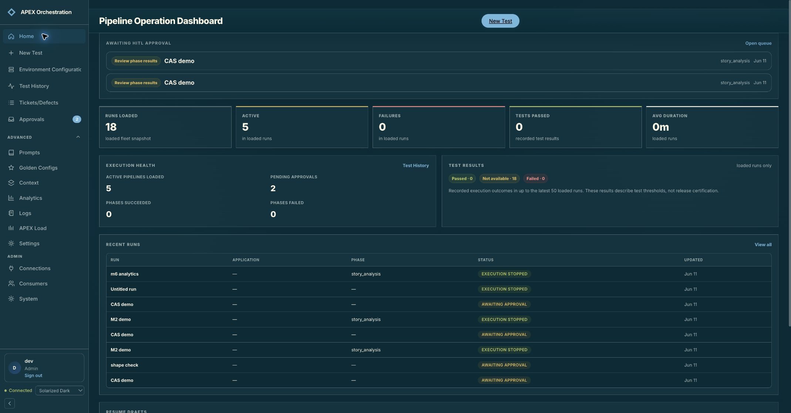

**Strength:** pending approvals lead the page and link directly to work. Test results explicitly distinguish threshold outcomes from release certification.

**Friction:** Active, pending approvals, and test results repeat across multiple regions. “Runs Loaded,” “loaded fleet snapshot,” “HITL,” and `story_analysis` describe implementation concepts. A prominent `0m` duration alongside absent results needs a clearer distinction between a measured short run and missing duration. Repeated fixture titles make runs hard to distinguish; real-data prevalence is unknown.

**Improve:** keep “Needs your attention” first, followed by active runs and recent outcomes. Use a single scoped metric strip, friendly phase labels, and explicit unknown values. Show application/environment and last-updated context before UUIDs.

### 2. New Test and configuration — understandable sections, unclear progression

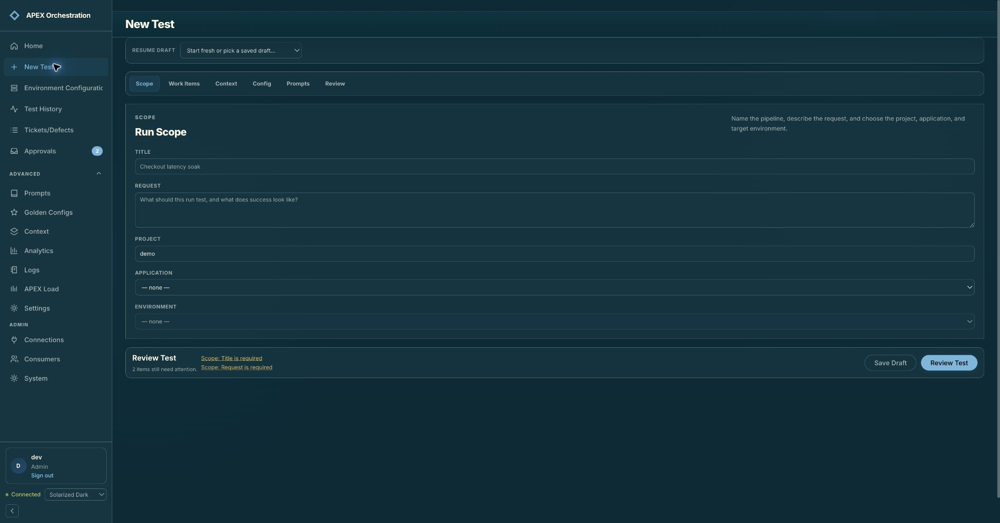

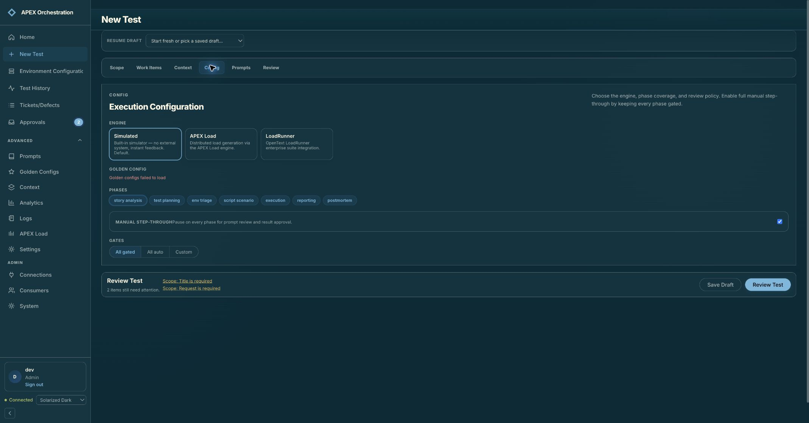

**Strength:** the form groups scope, work items, context, configuration, prompts, and review. Linked validation issues can take an operator to the relevant field. Engine descriptions clearly identify the simulator.

**Friction:** six peer tabs have no numbered progression or Next action; the first screen already presents validation alerts and a Review Test primary action. Project is free text, Environment is disabled without adjacent prerequisite guidance, and saved drafts share indistinguishable “Untitled run” labels. “Manual step-through” and “All gated” require users to interpret overlapping policy controls. The observed “Golden configs failed to load” has no local retry or next step.

**Improve:** adopt Load’s persistent Save draft / Back / Next / Review progression. Preserve direct section navigation for experts. Mark optional sections, explain dependencies beside disabled fields, show descriptive draft metadata, and consolidate review policy into one understandable choice with advanced per-phase overrides. Add recovery to the failed configuration picker.

### 3. Phase approval — highest UX priority

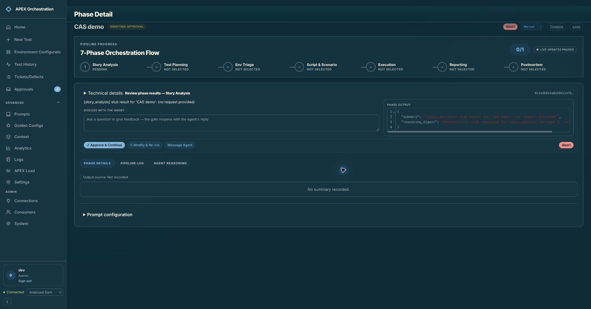

**Strength:** a clear Approve & Continue action, a discussion composer, phase navigation, and access to deeper evidence are present.

**Friction:** the visible state simultaneously says Awaiting approval, Pending, and Live updates paused. A large JSON preview competes with the decision; the section below says “No summary recorded” although the gate has output. Abort appears twice. The technical-details disclosure visually precedes the actual review heading, reducing its prominence. A seven-phase strip devotes most of its space to six unselected phases in this run.

**Improve:** lead with “Story Analysis is ready for your review,” a readable summary, changes since the prior attempt, warnings, source/evidence links, and what approval will do next. Put raw output and identifiers under Technical details. Explain draft review output versus accepted phase output explicitly. Use one destructive action location. Show streaming freshness separately from workflow status, and reduce unselected phases to an expandable summary.

**Accessibility:** ArrowRight on the selected Phase Details tab did not change selection or focus. Source corroborates `role="tab"` buttons with click handlers but no arrow-key handling or roving tab index. Implement the complete shared tab interaction pattern; test arrow keys, Home/End, tab-to-panel behavior, and focus visibility. The result-preview textbox had no accessible name in the captured tree. Small secondary controls and faint red JSON strings need measured contrast and target-size checks.

### 4. Test History — useful separation, excessive scanning effort

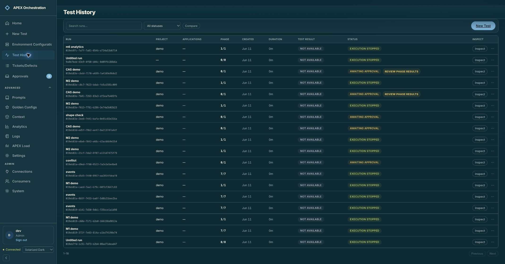

**Strength:** orchestration status and test result are separate columns; actionable approvals are linked. Search and a status filter are immediately available.

**Friction:** long UUIDs dominate each row, Phase is a fraction without a phase name, and “Inspect” competes with clicking the run name. Compare is offered before a selection workflow is explained. No project/application/environment/date controls are visible. Pagination differs from Load’s Rows / Previous / Next pattern.

**Improve:** apply Load’s search-first LibraryToolbar, optional filters with active indicators, consistent row actions, pagination, and comparison guidance. Lead with run name, application/environment, readable phase, outcome, and timestamp. Reveal IDs through copy/details. Preserve separate execution and acceptance semantics.

### 5. Run outcome — needs an overview before phase detail

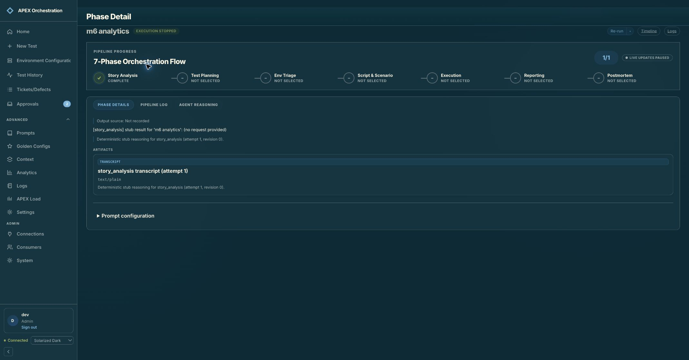

**Strength:** phase completion, artifacts, logs, and rerun controls are accessible. Missing source provenance is disclosed.

**Friction:** opening a history row lands directly in Phase Detail. “Complete” phase, “Execution stopped” run, and “Live updates paused” coexist without a plain-language explanation. The operator must reconstruct what happened and what to do next.

**Improve:** introduce a run Overview entry with outcome, stop/failure reason, completed coverage, acceptance status, evidence readiness, next action, and linked Load run. Keep Phases, Evidence, and Activity as drilldowns. Distinguish “execution did not run” from a failed test and from unassessed acceptance.

**Limit:** this connected fixture has stub outputs and no usable completed performance report. Full reporting composition, export, archive completeness, and the Load-to-Orchestration report round trip were not visually verified.

### 6. APEX Load handoff — blocked, without a recovery path

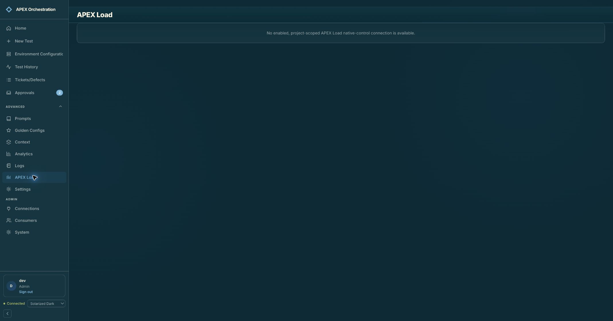

**Observed:** “No enabled, project-scoped APEX Load native-control connection is available.” The page offers no setup, permission guidance, retry, or direct open action. The sidebar still says Connected, which describes Orchestration connectivity rather than Load readiness.

**Improve:** show “Connect APEX Load to this project,” explain the missing prerequisite, and offer Manage connections to authorized administrators or a clear administrator contact path to operators. Show connection, mapped project, supported capabilities, and readiness. Keep the cross-app entry accessible outside the collapsed Advanced section.

**Limit:** the empty screen proves a configuration blocker, not a broken native API. No real workload or schedule was created to bypass it.

### 7. Settings — functional but behind Load’s personal-preference pattern

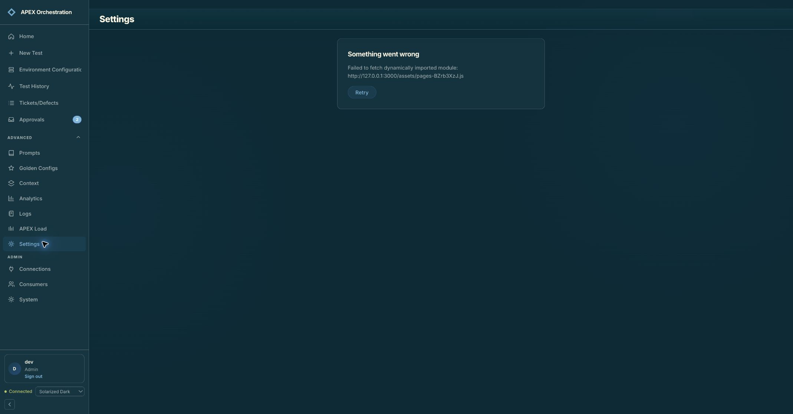

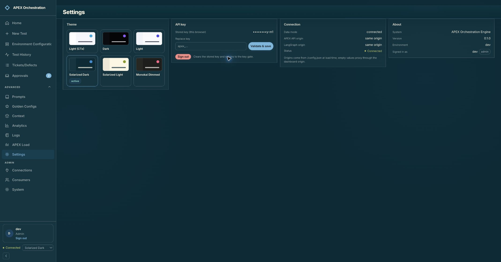

**Observed recovery:** Settings initially failed to fetch a dynamically imported module. Retry recovered the page. This is an observed runtime incident, not proof that Settings always fails. Replace the raw asset URL error with a useful update/reload message while retaining technical details for troubleshooting.

**Strength:** theme previews, active selection, masked credentials, and connection status are visible.

**Friction:** four broad columns mix preferences, credentials, runtime configuration, and account information. Six named themes include Light (CTx), while Load offers five themes plus System (Auto). No equivalent System, motion, default rows, or editor wrap preferences are present in the current Settings component. Settings lives inside Advanced despite being a routine operator need. The disabled Validate & save control still resembles an available primary action in this capture.

**Improve:** share the Personal preferences model and visual components with Load. Organize Appearance, Tables & editor, Notifications where supported, and Account; place connection diagnostics and credential management separately. State browser-only versus account-wide persistence explicitly.

### 8. Load comparison — reuse current patterns, not an older running bundle

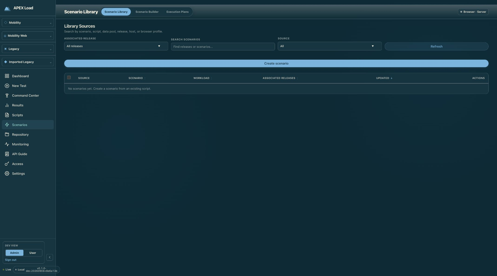

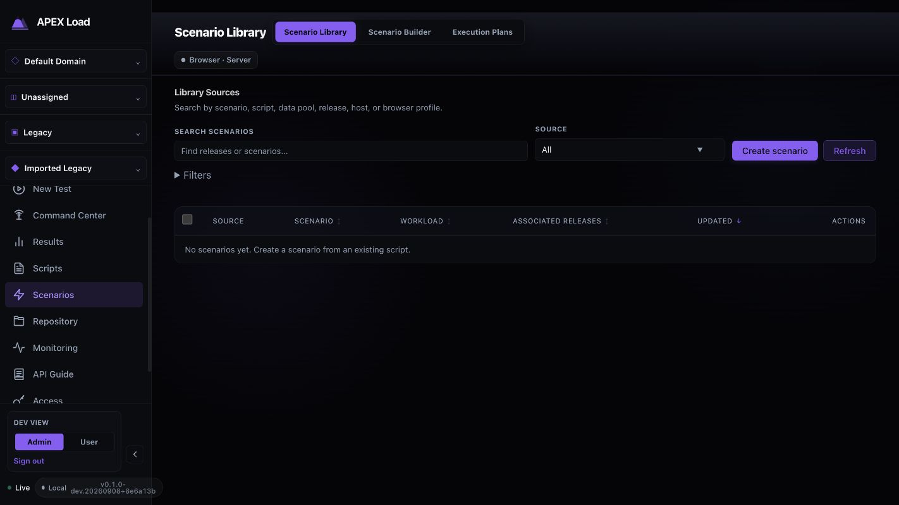

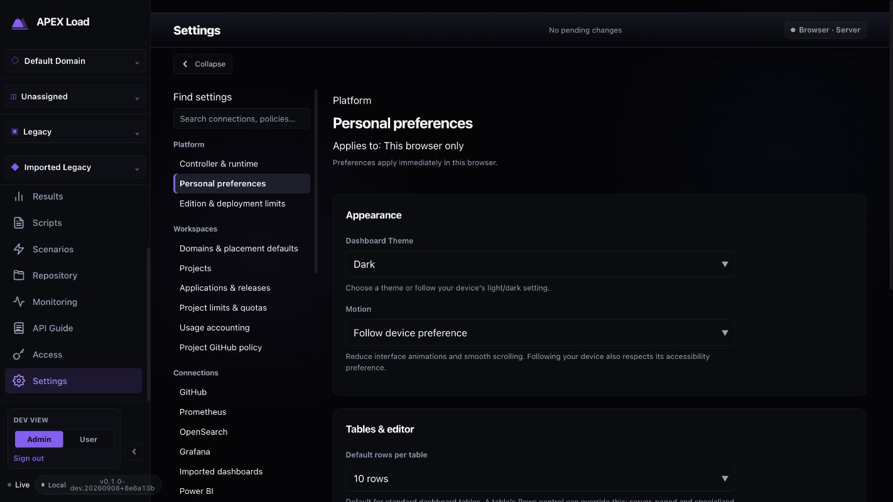

The latest library has search-first placement, compact creation/refresh actions, optional filters, and sortable table headings. Preferences have clear categories, field-level explanations, scope, and immediate-save feedback. Both products already share the dark surface family, accent vocabulary, sidebar treatment, and typography direction. Orchestration’s square panels versus Load’s rounded cards, differing button/tab shapes and density, and inconsistent page-header placement still create visible drift.

Do not copy the older running Load library’s full-width creation bar: the supplied task already replaced that pattern. Do not copy every Load screen verbatim either; Orchestration’s agent approvals and phase evidence need their own content hierarchy.

## Integration opportunities and existing foundations

| Opportunity | Existing foundation verified in source | Recommended experience / contract |
|---|---|---|
| Context-preserving app switch | Load has domain/project/application/release selectors; Orchestration has project-scoped native connections and remote project bindings | A shared app switcher carries mapped project, application, environment/release where supported, plus a validated return route. If mapping is missing, explain and request a selection; never silently choose a different project. |
| Bidirectional run navigation | Native run console URLs already target `/#/test/{run_id}`; mirrored-run records link reporting pipelines | Show “Open load execution” from Orchestration and “Open orchestration analysis” from Load. Preserve run selection and return to the exact originating context. Reverse navigation is a proposed extension, not verified existing behavior. |
| Automatic post-test analysis | Reconciler already polls native runs, collects artifacts, and starts reporting/postmortem with idempotency | Surface “Analysis queued / collecting evidence / ready / needs attention” next to a completed Load run. Expose retry against the same analysis identity, avoiding duplicate pipelines. |
| One trustworthy outcome | Direct adapter reads SLA status; native handoff currently derives passed from terminal status | Share execution status, threshold assessment, acceptance/release decision, evidence completeness, and provenance as separate fields. Present the same meaning in both products. |
| Scenario preparation and capacity | Native control supports capabilities, scenario validation/sizing/create, schedules, calendar/health, and approvals | Use structured scenario summaries and a readiness checklist. Hand off advanced workload editing to Load. Keep native schedules as the launch authority; do not introduce a second scheduler. |
| Evidence and defects | Artifact collection and reporting/postmortem exist; Orchestration has work-item routes | Link defects to exact run, scenario version, evidence, and breached objective. Show artifact source and collection time. Reuse stable references instead of copying unversioned report text between apps. |
| Shared preferences and authentication | Both store local theme preferences; credentials and roles are app-specific | First standardize preference names/tokens. Cross-origin preference synchronization requires an explicit profile service or validated handoff; localStorage does not synchronize across ports/origins. Shared sign-in would be a separate identity design, not API-key copying. |

### Priority finding: completed is not necessarily passed

**Code-confirmed mismatch, not a reproduced production misclassification:** `src/apex/services/apex_load_native.py:97` sets `passed` solely from `claim.status == "COMPLETE"`. That payload is passed into the reporting/postmortem pipeline at lines 264–277. The direct adapter reads `/sla-status` and combines completion with `not breached` in `src/apex/adapters/apex_load/engine.py:2462` and `:2536`.

A completed run with an SLA breach can therefore be handed to native reporting with a misleading passed flag. Align both paths with a documented authoritative assessment contract; include unknown/not-assessed when evidence or configured acceptance criteria are absent. Do not assume that eliminating this one mismatch settles all acceptance semantics.

## Prioritized implementation backlog

P1 = operator decision/recovery or outcome trust; P2 = workflow efficiency and consistency. These are proposed work items, not completed changes.

| ID | Priority | Work item | Acceptance criteria |
|---|---|---|---|
| U01 | P1 | Unify native/direct result semantics | Completed run with breached SLA never produces passed input; missing assessment remains explicit; stopped/failed runs retain correct reasons. Contract tests cover both ingestion paths. |
| U02 | P1 | Redesign approval hierarchy | Summary, warnings, evidence, next action precede raw output; one destructive-action location; review output vs accepted output clear; status language consistent. |
| U03 | P1 | Recover from missing Load connection | Admin has a setup route; operator has actionable permission guidance; project mapping and readiness visible; refresh returns to intended run/setup context. |
| U04 | P1 | Standardize accessible tabs and evidence controls | Arrow keys, Home/End, roving focus, panel relationships and accessible editor names work. Contrast/focus/target measurements pass agreed accessibility checks. |
| U05 | P2 | Share APEX shell and design primitives | Versioned tokens plus PageHeader, tabs, buttons, fields, dialogs, library controls, and status components; documented domain exceptions; matched screenshot checks across shared themes. |
| U06 | P2 | Make setup progression explicit | Back/Next/Review and Save draft have distinct meanings; prerequisite failures have recovery; draft context survives detours; one review-policy control with clear overrides. |
| U07 | P2 | Add outcome-first run overview | History opens a readable outcome/coverage/evidence summary, with exact Load execution link and appropriate next action; all incomplete and stopped states tested. |
| U08 | P2 | Align libraries and dashboard hierarchy | Search/filter/selection/row actions/pagination consistent with Load; active filters obvious; human context precedes UUIDs; redundant metrics removed without losing coverage. |
| U09 | P2 | Align personal preferences and navigation | Settings outside Advanced; common System/theme/motion/rows/wrap preferences supported where meaningful; browser/account scope explicit; non-admin route verified. |
| U10 | P2 | Surface bidirectional integration and analysis readiness | Stable IDs and validated mappings preserve scope; reverse navigation and analysis status work; retries do not duplicate reporting pipelines or schedules. |
| U11 | P2 | Improve loading/error/deployment recovery | Golden-config picker can retry; stale lazy-module errors recover with clear copy; unknown and empty states stay distinct; forms survive recoverable failures. |

Recommended delivery order: U01–U04 first, then shared primitives (U05), setup/overview/libraries/preferences (U06–U09), and the integrated handoff (U10). Apply U11 throughout rather than leaving recovery until the end.

## Verification boundaries

Read-only browser navigation, current screenshots, selected keyboard behavior, and targeted source inspection were used. No runs were launched, approved, stopped, or rerun; no connections, scenarios, schedules, settings, or credentials were saved. The original Orchestration route, theme, and expanded Advanced navigation were restored. No application tests were run because no application code changed.

The requested 923 × 987 Chrome viewport override did not change the actual page viewport; it was reset, and the duplicate capture was not accepted as narrow-width evidence. Narrow/zoom reflow remains unverified. Only the observed themes were reviewed, not the complete theme matrix. No screen-reader certification, measured contrast audit, exhaustive dialog/focus audit, real completed report export, native connection round trip, or non-admin Orchestration session was tested. Environment, work-item, prompt, context, analytics, and administration editors need their own detailed follow-up coverage.

Next implementation pass should start with outcome semantics and the approval workspace, using the current Load components as the shared interaction reference.
